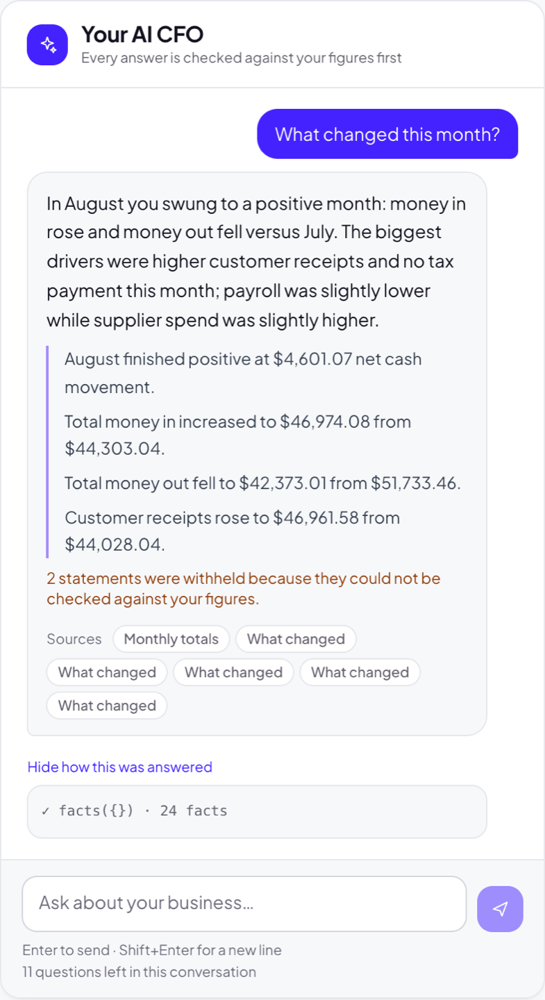
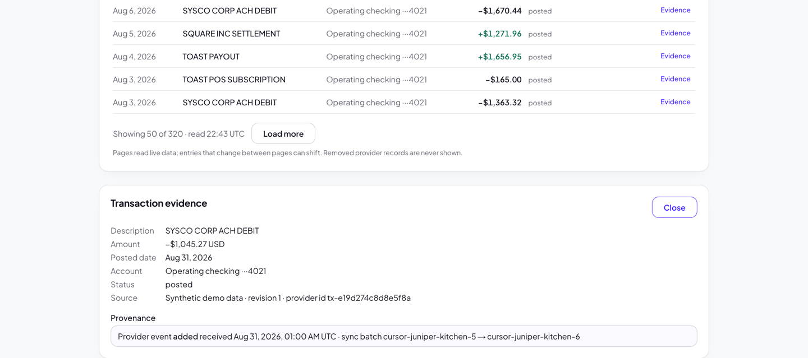
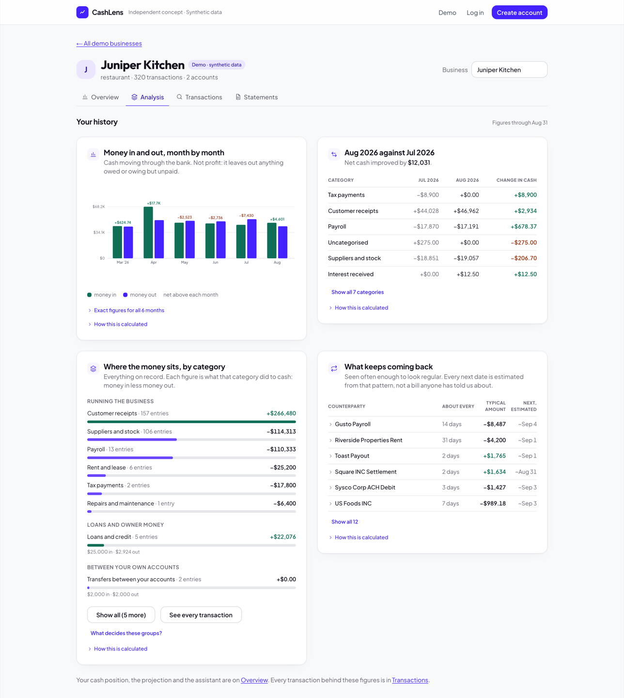
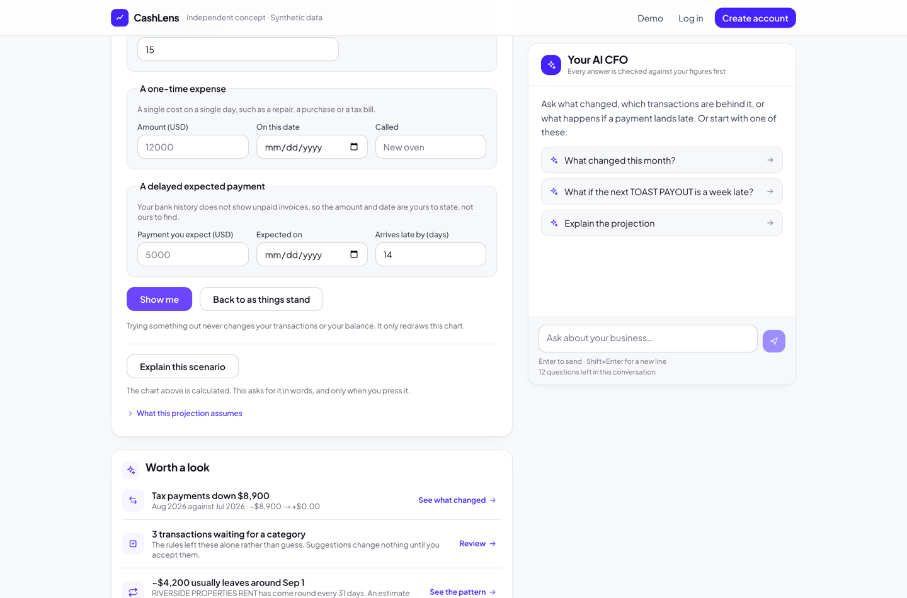
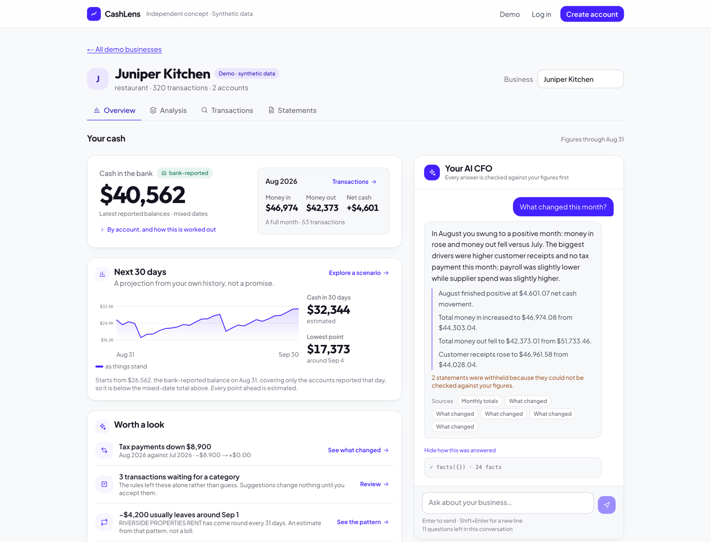
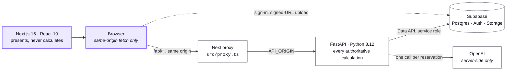
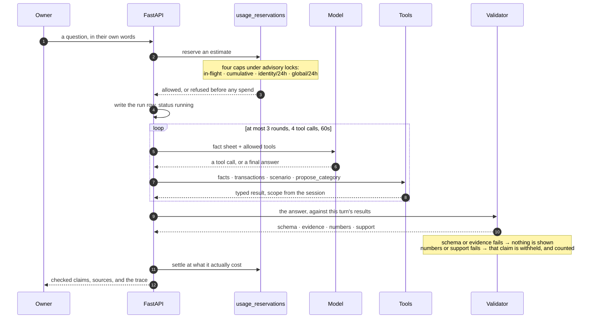
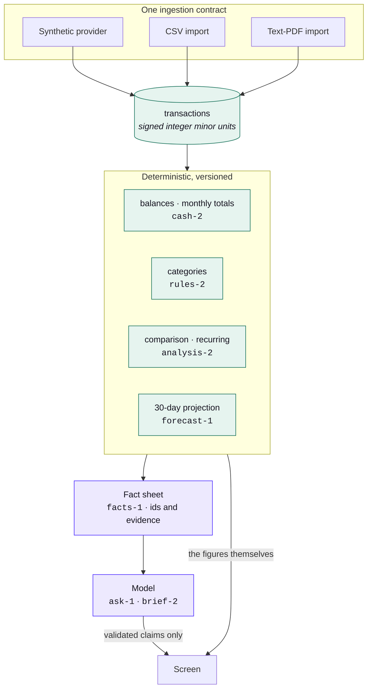
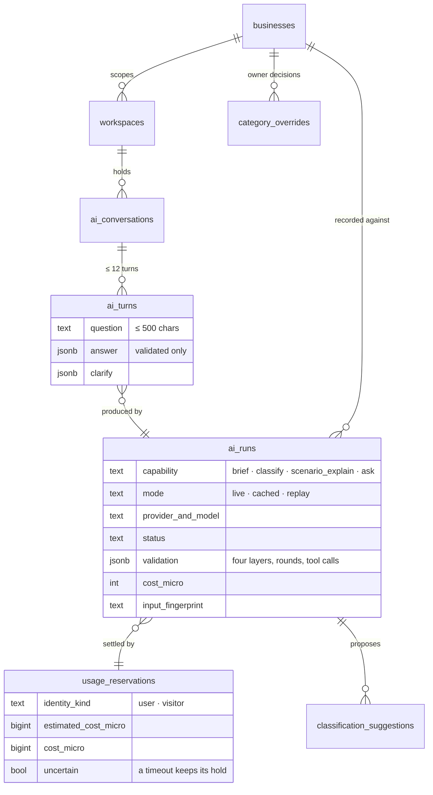

# CashLens

An AI CFO for small businesses. It reads a business's bank transactions, works out what changed
and what is coming up, and explains it in plain words, with the figures in each claim checked
against the data and any claim that fails withheld.

It is built for an owner who has a bank account and no finance team: someone who can see their
balance but cannot easily answer "why is this month different?" or "what happens if that payment
lands a week late?". There is nothing to set up to look around. Three fictional businesses run on
generated bank history and need no account and no upload.

> **Try it: https://cashlens-web.vercel.app.** The three synthetic demo businesses need no
> account and nothing to upload.
>
> This is an interview demo release, not a finished product. Accounts and statement uploads are
> reachable there too, but their release prerequisites are **not** done: confirmation email
> delivery is unverified, there is no custom mail provider, and no retention schedule is
> running, so an uploaded file is not cleaned up on any timetable. Do not put a real bank
> statement into it. What is finished, what is unevaluated and what is deferred are all in
> [Release status](#release-status) below.

---

## What it does

**A conversational AI CFO.** Ask about the business in your own words. The model never sees the
database; it calls four typed tools over the same code that draws the dashboard, and each claim
it makes is checked against the figures those tools returned. A claim that fails is withheld and
counted, in the open.



**Transaction evidence.** Every figure leads back to the rows behind it. An evidence panel shows a
transaction's amount, dates, account, status, source and provenance, down to the sync batch it
arrived in.



**Category review.** Descriptions the rules cannot read are left alone rather than filed somewhere
plausible. The model proposes a category; nothing moves until a person accepts it, and what they
choose is recorded as their decision, not as something the model learned.

**Deterministic cash analysis.** Balances, monthly totals, categories, a month-against-month
comparison and repeating-payment detection are all computed in Python from integer minor units.
The model explains them; it never produces them.



**Scenarios.** Three what-ifs, applied to a 30-day projection: scale customer receipts, add a
one-off cost, or delay an expected payment. Applying one redraws the chart and touches no stored
transaction or balance.



**CSV and PDF statement imports.** For a signed-in private business: upload, map columns, review
every row with duplicate candidates flagged, then confirm atomically against a revision number.
Identical files in the same account return the existing import rather than creating a second one.

It is built and tested, and it is reachable on the public deployment, but its release
prerequisites are not finished: see [Release status](#release-status). Treat it as a
demonstration of the flow rather than somewhere to put a real statement.

---

## Try the demo

The overview is the whole product in one screen: where the cash is, where it is heading, what is
worth a look, and somewhere to ask.



A three-minute walkthrough on **Juniper Kitchen**, a fictional restaurant with six months of
generated history, at **https://cashlens-web.vercel.app**:

1. From the landing page choose **Explore live demo**, then **Juniper Kitchen**. No account, no
   upload.
2. On **Overview**, read the cash position and the next 30 days. The projection says what it
   starts from and that every point ahead is estimated.
3. Press **Explore a scenario**, set receipts to `15`, then **Show me**. The chart keeps both
   lines and reports the difference against the baseline. **Back to as things stand** resets it.
4. Open **Analysis** for the month-by-month history, what changed against last month, categories
   by their net effect on cash, and what keeps repeating. Expand a repeating payment to see the
   bank's own description and the transactions behind it.
5. Back on **Overview**, ask the AI CFO **What changed this month?**, then open **How this was
   answered** to see which tools ran, which model answered, what it cost, and how each validation
   layer came out.

Step 5 is the only step that spends money, and only when you press it.

---

## How it is built

**Next.js 16.3.5** (App Router, React 19.2.8, Tailwind 4.3.3, TypeScript 5.9.3) presents and
forwards. It never duplicates a calculation. The browser only ever calls its own origin: a Next
proxy at `apps/web/src/proxy.ts` forwards `/api/*` to the API, and strips any bypass header a
client tries to supply. It talks directly to Supabase for sign-in and for uploading a statement
file to private Storage with a one-path signed URL.

**FastAPI 0.141.1 on Python 3.12** holds every authoritative calculation and all AI
orchestration. Business scope is derived from the session on the server, never from a client
argument or a model argument.

**Supabase** provides Auth, Postgres reached through the Data API, and a private Storage bucket.
Twenty-four SQL migrations live in `db/migrations` and are applied by `db/migrate.py`, which
tracks checksums and refuses a changed file as drift.

**Deterministic calculations, versioned.** `analysis-2`, `cash-2`, `rules-2`, `forecast-1`, with a
`fp-1` input fingerprint. The same inputs always produce the same metrics, whether they came from
generated data or an uploaded statement. Money is stored as signed integer minor units. A
statement's closing balance is historical evidence, never today's cash; an incomplete month is
never compared as a complete one.

**Bounded AI tools.** A conversation turn runs at most three model rounds, four tool calls and one
scenario computation, under a sixty-second deadline, with a conversation capped at twelve turns.
The four allowlisted tools are `facts`, `transactions`, `scenario` and `propose_category`. None of
them takes a workspace or business argument, so a guessed identifier cannot widen scope. Prompt
versions are pinned (`brief-2`, `classify-1`, `scenario-explain-4`, `ask-1`, `cashflow-1`) against
a versioned fact sheet.

**What the model is not asked.** Cash-flow classification sorts every row of an upload into one of
eleven buckets, six for money in and five for money out plus a shared `Unclassified`. Which
direction a row is belongs to arithmetic, not to the model: it is computed from the amount before
the batch is built, told to the model as settled, and re-checked after it answers, so a category
from the wrong direction is refused rather than displayed. The same refusal applies to a person
correcting a row. The uploaded file's own category column is never sent, because what is sent is an
allowlist of columns rather than a filtered copy of the row.

**Validation, reported in four layers.** Each answer is checked for `schema`, `evidence`,
`numbers` and `support`. A schema or evidence failure rejects the whole answer. A numbers or
support failure withholds the individual claim and shows the rest, saying how many were withheld.

> These layers establish that a figure cited in a claim appears in the fact sheet and that a
> referenced transaction exists. **They do not establish that an answer is correct, and their
> coverage is not total.** Schema proves shape. Evidence does not prove relevance. Support is a
> keyword and phrase test, not comprehension: it will pass a sentence that is fluent,
> on-vocabulary and still a poor reading of the business, and it cannot detect an omission. The
> number check reads a claim's structured figures, and money and percentages written inside a
> claim's own text; it does not currently read percentages or unmarked numbers in the summary
> line, or any number inside a caveat or a follow-up question. A judged measure against a
> held-out set would address the comprehension gap, and it has not been built.

**Usage reservations.** No paid call happens without a reservation that a concurrent request
cannot also obtain. Four caps are checked inside one SQL function under advisory locks: in-flight
concurrency per identity, a cumulative total with no time window, a rolling 24-hour identity cap
and a rolling 24-hour global cap. A timed-out call deliberately keeps its held estimate rather
than refunding budget.

**Run traces.** Every generation attempt writes a row recording capability, mode, provider, model
requested and used, prompt and calculation versions, input fingerprint, status, the validation
record, attempts, latency, tokens, cost and where the cost figure came from. Mode is derived from
the adapter's own `live` flag, so a simulated or replayed answer can never be presented as live
model performance.

Architecture drawings are in [docs/diagrams](docs/diagrams/README.md). They are **proposed-design
drawings from September 2026, not descriptions of the shipped code**, and some of what they show
was never built. Where they and the code disagree, the code is right.

---

## Engineering

Four diagrams, written from the code rather than from a plan. They render here on GitHub, so
they are diffed and reviewed like everything else and cannot quietly drift out of date the way
an exported image does.

### The request path

Two deployments and one database. The browser never calls the API's origin: a Next proxy
forwards `/api/*` server-side, which is also where the preview bypass header is attached, so no
credential reaches the bundle. The only other origin the browser talks to is Supabase, for
sign-in and for uploading a statement file straight to private storage with a one-path signed
URL.



Business scope is derived from the session on the server. No route takes a workspace or business
id from the client or from the model, so a guessed identifier cannot widen access.

### One AI question, end to end

This is the part worth reading. The model never sees the database; it calls four typed tools over
the same code that draws the dashboard. Money is reserved **before** anything is dispatched, and
the answer is checked against the figures those tools actually returned before any of it reaches
the screen.



A timed-out call deliberately keeps its held estimate rather than refunding it, so an uncertain
outcome cannot quietly free budget.

### Code computes, the model explains

Every figure on screen is produced in Python from integer minor units and handed to the model as
a fact sheet. The model's job is words. A claim that cites a figure absent from that sheet does
not survive validation.



An input fingerprint (`fp-1`) covers everything the figures were computed from. A stored brief
whose fingerprint no longer matches is shown as stale rather than silently regenerated.

### What the AI layer persists

Every generation attempt writes one row before it is dispatched, so a call that dies still leaves
a record. Tool traces and the validation outcome live on the run; the raw model text never does.



`mode` is derived from the provider adapter's own `live` flag rather than its name, so a
simulated or replayed answer can never be reported as live model performance.

### Reading the code

A file-by-file walkthrough, written from the code and checked line reference by line reference,
is in **[docs/CODE-TOUR.md](docs/CODE-TOUR.md)**. It follows the data rather than the folders:
where a figure comes from, what happens to it, and which file to open at each step. It ends with
a suggested route through eight files if you want to walk someone else along it.

### The original design drawings

The drawings made before any of this was built are in
[docs/diagrams](docs/diagrams/README.md). They are worth reading as a record of the intended
design, and their own footers say **proposed architecture**. Two places where they and the code
disagree, because the code is what shipped:

- `09-statement-upload` shows bounded AI assistance inside PDF extraction. That was deferred and
  never built; extraction is deterministic parsing only.
- `11-import-jobs-and-ai` names `financial_snapshots` and `tool_calls`. Neither exists. Tool
  traces are stored on `ai_runs.validation` and `ai_turns.tool_calls`, and the tables that do
  carry this work are the four above plus `usage_reservations`.

`08-current-system` and `10-private-data-model` still describe what is there.

---

## Running it locally

Node 24 (`.nvmrc`) and Python 3.12 (`services/api/.python-version`). Nothing else is installed
globally.

API, from `services/api/`:

```bash
python3.12 -m venv .venv
.venv/bin/pip install -r requirements-dev.txt
.venv/bin/uvicorn app.main:app --reload --host 127.0.0.1 --port 8000
```

Web, from `apps/web/` in a second terminal:

```bash
nvm use
npm ci
npm run dev
```

Open http://localhost:3000. With no configuration at all, both services start: the API answers
`/api/health` and the web app serves the landing page with a scaffold notice. **That is not the
demo.** To see the product you need a Supabase project.

Copy the two `.env.example` files, which list every name below, and fill them in:

- `services/api/.env` needs `SUPABASE_URL` and `SUPABASE_SERVICE_ROLE_KEY`. Every demo route
  depends on them.
- `apps/web/.env.local` needs `NEXT_PUBLIC_SUPABASE_URL` and
  `NEXT_PUBLIC_SUPABASE_PUBLISHABLE_KEY`. Without them the product pages do not render.
  `API_ORIGIN` is optional locally and defaults to the API's local address.

Then, from the repository root with `SUPABASE_DB_URL` set, apply the schema and load the demo
businesses:

```bash
python3 db/migrate.py apply
cd services/api && .venv/bin/python -m app.synthetic.seed
```

AI is off until you switch it on. `AI_ENABLED` plus `AI_PROVIDER=simulated` gives a working AI
interface with no model credential and no spend, which is enough to click through every surface.
For real answers set `AI_PROVIDER=openai` with `AI_MODEL` and `OPENAI_API_KEY`; the caps
`AI_IDENTITY_DAILY_COST_CAP_MICRO`, `AI_GLOBAL_DAILY_COST_CAP_MICRO` and
`AI_MILESTONE_TOTAL_CAP_MICRO` bound what it can spend. Signed-in flows also need the
deployment's `/auth/callback` URL on the Supabase project's redirect allowlist.

No credential values appear anywhere in this repository, and none are needed to read it.

### Checks

```bash
cd apps/web      && npm run lint && npm run typecheck && npm run build
cd services/api  && .venv/bin/ruff check . && .venv/bin/ruff format --check . && .venv/bin/pytest
```

389 API tests. The same checks run in GitHub Actions on every push, with no database, no network
and no secrets.

---

## Release status

**Working and checked.** The four workspace sections for both demo and private businesses; the
deterministic calculations and their versioning; the three scenario controls applying and
resetting without touching stored data; the conversation panel with its bounded tool loop,
four-layer validation, source chips and run trace; the structural refusal to substitute a
repeating payment for an unspecified one; evidence navigation from a figure to its transactions;
CSV and PDF import with staged review and atomic confirmation. 389 API tests and the web lint,
typecheck and build pass in hosted CI.

**Built but not evaluated.**

- **Model choice.** Direct OpenAI (`gpt-5.2-2025-12-11`) is the showcased provider because it is
  what has been exercised, not because a comparison chose it.
- **OpenRouter.** The adapter is implemented, restricted to synthetic demo businesses, and sends
  explicit routing preferences with a price ceiling. It is **experimental and hidden from the
  interface** for this release: every attempt so far returned an invalid output, three of three.
  Hiding it is one constant in `services/api/app/ai/routing.py`; the route still answers an
  explicit request, so the unfinished comparison remains runnable. Neither provider is described
  as better than the other, because no comparison has been run.
- **Verification depth.** The acceptance journey has been run against a local API and the
  development database, not end to end through the deployed preview. Latency and cost figures come
  from development runs on one dataset.

**Deferred, and not claimed.** Held-out evaluation, the pre-registered decision rule and the
recorded evaluation run. The provider comparison. A/B testing and analytics, which are not
started. Automated retention: no cleanup schedule is activated, so an abandoned upload holds its
quota slot until a cleanup run actually happens.

**Known limitation a reviewer could meet.** On a phone, the Transactions page can be dragged
sideways by about 218 px. The table's own scrolling works; the page-level scroll is documented
rather than fixed. Overview and Analysis do not do this.

The full picture, including every public-release prerequisite that is still open, is in the
[implementation checklist](docs/planning/IMPLEMENTATION-CHECKLIST.md#interview-demo-release). The
reasoning behind the AI boundary is in [ADR 0011](docs/decisions/0011-grounded-ai-and-provider-boundary.md),
[ADR 0012](docs/decisions/0012-routed-models-and-figure-references.md) and
[ADR 0013](docs/decisions/0013-interactive-ai-cfo-panel.md).

---

## Repository

```
apps/web         Next.js frontend: presents and forwards, never calculates
services/api     FastAPI backend: calculations, AI orchestration, authorization
db/migrations    23 SQL migrations, applied by db/migrate.py
db/checks        operational checks against a running API
docs/planning    plans and the implementation checklist
docs/decisions   architecture decision records, 0001 onward
docs/diagrams    proposed-design drawings, not descriptions of shipped code
docs/screenshots the images above, from the synthetic demo businesses
```

Start with [START-HERE.md](START-HERE.md) and the
[implementation checklist](docs/planning/IMPLEMENTATION-CHECKLIST.md). The
[statement import plan](docs/planning/CashLens-Statement-Import-Plan.md) supersedes the
synthetic-only scope in the older
[blueprint](docs/planning/AI-CFO-Engineering-Blueprint.md) and
[playbook](docs/planning/AI-CFO-Playbook.md).

## Access

The code is developed in a private GitHub monorepo; this public repository is a snapshot of it, published as described in [ADR 0002](docs/decisions/0002-private-repository-and-deployment.md). `main` carries this release.

**https://cashlens-web.vercel.app** is public and serves the whole application: the synthetic
demos with no sign-in, and accounts, private workspaces and statement imports for anyone who
creates one.

Access to private data is enforced by the application. A workspace resolves only for the
visitor or the authenticated member it belongs to, checked on the server against business
memberships, so one account cannot read another's business by guessing an id.

Two things a reader should know about that deployment. It shares a database with the author's
own private businesses, so the separation between accounts is the application's authorization
and not a separate database. And the public-release prerequisites below are not finished, in
particular confirmation email delivery and any running retention or cleanup schedule.

The codebase also supports a **synthetic-only** mode, `PUBLIC_DEMO_ONLY`, which refuses every
private path and every workspace that is not a demo, in the API rather than only in the
interface. It is off on this deployment and is the safer shape for a genuinely public release.

Credentials, real financial documents and personal financial material are never committed,
whatever the repository's visibility. See
[ADR 0002](docs/decisions/0002-private-repository-and-deployment.md) and
[ADR 0004](docs/decisions/0004-deployment-topology-and-protection.md).

CashLens is an independent concept. All demo data is synthetic. No affiliation with any existing
product is implied.
