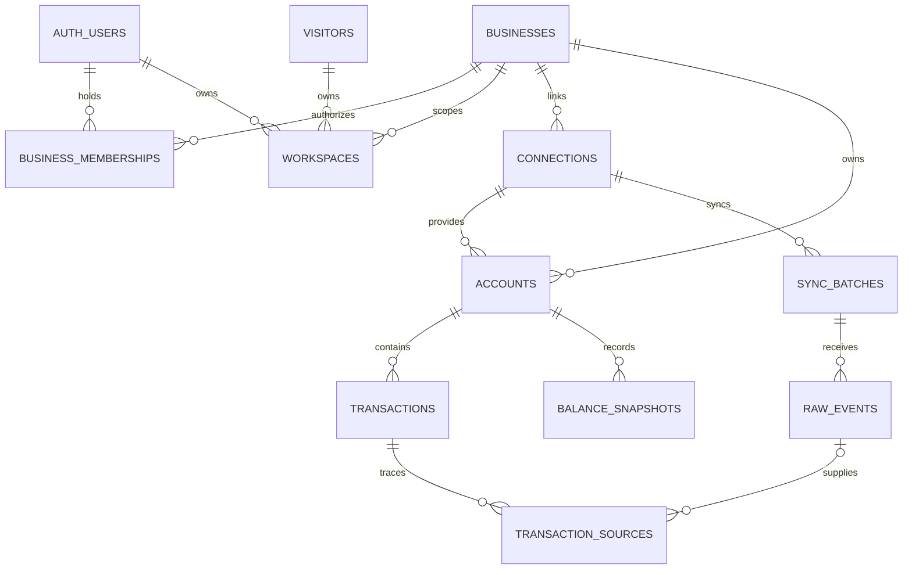

# CashLens data contract

Status: current as of milestone 7 (September 13, 2026). This document
reconciles the synthetic baseline schema in
[AI-CFO-Flows-and-Data-Model.md](planning/AI-CFO-Flows-and-Data-Model.md)
with the private-import extension in
[CashLens-Statement-Import-Plan.md](planning/CashLens-Statement-Import-Plan.md).
Where they disagree, the import plan wins and the resolution is recorded in
the last section. Tables marked *deferred* are designed here but created in
the milestone that first needs them.

## 1. Entities and relationships

Implemented in migration `0002_foundation.sql`:

| Table | Role | Key relationships |
|---|---|---|
| `businesses` | A demo or private business; the scope of all financial data | `data_mode` = demo or private; `(id, data_mode)` is unique so children can reference the mode |
| `business_memberships` | Authenticated users who may access a private business | PK `(business_id, user_id)`; `user_id` → `auth.users`; composite FK forces `data_mode = private`; optional `provisioning_key`, unique per user, makes an explicitly requested additional business idempotent |
| `visitors` | Opaque browser identities for demo exploration | No personal data; created by the API |
| `workspaces` | One mutable view per identity per business | Exactly one of `visitor_id` (demo) or `user_id` (private); private workspaces must match a membership row |
| `connections` | A provider link owned by a business (synthetic now, bank connector later) | Holds the sync cursor |
| `accounts` | Depository accounts | `source_type` decides whether a connection is required; `(id, business_id)` unique for scoped FKs |
| `sync_batches` | One applied page set from a provider | Cursor range and status |
| `raw_events` | Every provider operation as received | Lineage for replay; `(batch, sequence)` unique |
| `storage_cleanup` | Files still to remove from Storage | No foreign key on purpose: it outlives the business and import rows it came from, so a failed removal stays retryable. Holds a path, an attempt count and an error code, never statement content |
| `transactions` | Canonical transactions | Scoped FK `(account_id, business_id)`; optional provider `external_id`; pending link; `removed_at` |
| `transaction_sources` | Which raw event or import row produced or supports a transaction | Exactly one origin per row (`raw_event_id` or `import_row_id`); many sources may support one transaction |
| `balance_snapshots` | Dated balances by kind and provenance | Scoped FK to accounts; statement closing balances are never "today's cash" |
| `document_imports` | One uploaded statement file (CSV or PDF) and its review state (M6, M7) | Private businesses only via composite FK; scoped FK to the account; object path and content hash; status, revisions, safe error, expiry |
| `import_jobs` | Leased, bounded processing steps for an import (M6) | Unique idempotency key; attempts capped |
| `import_rows` | Staged rows: raw cells, extraction, owner corrections, flags, decision and who made it, page number (M6, M7) | Unique `(import_id, row_index)`; retained after confirmation as provenance |

Deferred, with the extension point each will attach to:

| Deferred table | Milestone | Attaches to |
|---|---|---|
| `classification_suggestions`, `category_overrides` (designed as `classifications`, `overrides`) | M10, designed in [ADR 0011](decisions/0011-grounded-ai-and-provider-boundary.md) | `transactions` with the revision recorded on each row; both workspace-scoped through a composite `(workspace_id, business_id)` key. Rule classifications are recomputed, not stored |
| `assumptions` | deferred | `workspaces`; persisted owner assumptions are not in M9 or M10 |
| `financial_snapshots`, `scenarios`, `insights`, `insight_transactions`, `tool_calls` | not created | M9 computes live and M10 stores validated results with evidence ids on `ai_runs`; there is no tool loop (ADR 0011) |
| `ai_runs`, `usage_reservations` | M10, designed in ADR 0011 | `ai_runs` on `businesses` with nullable `workspace_id` and `import_id`, so extraction runs can precede a workspace; `usage_reservations` keyed by the spending identity (user or visitor) |
| `experiments`, `assignments`, `analytics_events` | M12 | `visitors`; demo mode only |

## 2. Ownership and authorization boundaries

- A demo business is shared, read-only seed data. Its rows in `businesses`,
  `connections`, `accounts`, `transactions` and `balance_snapshots` are
  immutable: a trigger rejects insert, update and delete unless the session
  sets `cashlens.allow_demo_mutation = 'on'` and is a direct `postgres`
  operator session (migrations and the seed loader). The API's service role
  cannot lift immutability; client roles cannot write at all.
- A private business is reachable only through `business_memberships`. A
  browser visitor identifier never authorizes access to private data: the
  `workspaces` constraints make a visitor workspace demo-only and a user
  workspace private-only, and the user workspace must match a membership.
- Row Level Security is enabled on every table. Explicit grants replace this
  project's default privileges, which would otherwise give the API roles
  truncate, references and trigger on new tables.
  - `anon` and `authenticated` may select demo rows of businesses, accounts,
    transactions and balance snapshots; `authenticated` may additionally
    select private rows of businesses it is a member of and its own
    memberships.
  - No client role may write. Visitors, workspaces, connections, sync
    batches, raw events, transaction sources, document imports, import jobs
    and import rows have no client access at all. The private `statements`
    Storage bucket has no client policies either: uploads use one-path signed
    tokens issued by the API and reads happen only server-side.
  - `service_role` has full data access and bypasses RLS; the API uses it and
    is therefore responsible for a membership check on every private request.
- Provisioning happens only through two service-role functions:
  `ensure_demo_workspace(visitor, slug)` for demo visitors and
  `provision_private_business(user, name, key)` for signed-in users. Both are
  idempotent, lock per identity, and are not executable by client roles.
  Without a key the second resumes the caller's earliest business; with a
  caller-scoped key it creates or returns the additional business that key
  identifies (ADR 0006 amendment). A user may own several private businesses;
  the API resolves one only through the caller's own membership.
- Scope is enforced structurally: composite foreign keys such as
  `(account_id, business_id)` make it impossible to attach a transaction to
  an account of another business, and a guessed valid id grants nothing
  because policies check membership, not id knowledge.

## 3. Money and date conventions

- Amounts are `bigint` minor units, USD only (`currency = 'USD'` is a check
  constraint). Inflows are positive, outflows negative, zero is rejected.
- Each source adapter converts its own sign convention. The synthetic
  provider mirrors Plaid: a positive provider amount is money leaving the
  account, so canonical = −(provider amount × 100).
- `posted_date` is a calendar date in the account's local convention; it
  carries no time zone. Timestamps (`as_of`, `created_at`) are `timestamptz`.
- Pending transactions are excluded from posted totals. A pending row that
  later posts is linked from the posted row via `pending_transaction_id` and
  the pending row is marked removed; amounts may differ.
- A balance snapshot has a `kind` (current, available, statement_closing,
  statement_opening)
  and a `provenance` (bank_observed or owner_confirmed). Projections never
  start from a statement closing balance without saying so.
- Periods that are not complete must not be compared as complete weeks; the
  fixtures include a frozen demo date so calculations can detect this.

## 4. Source provenance

- `source_type` on accounts and transactions: `synthetic_provider`,
  `csv_import`, `pdf_import`, `bank_connector`. Import rows carry the page
  number and a `page N line M` or `line N` locator as provenance.
- Provider-fed accounts require a connection and an external account id;
  manual-import accounts have neither.
- Every transaction has at least one `transaction_sources` row pointing at
  the raw provider event or the import row that produced it; later events
  and linked import rows add further sources. Raw events are never edited;
  corrections arrive as new events. Raw events also carry the adapter's
  canonical reading (`canonical`) so the database can apply them without
  provider-specific logic.
- `balance_snapshots.provenance` distinguishes what the bank reported from
  what the owner confirmed. Inferred and projected figures are calculation
  outputs and are never stored as snapshots.

## 5. Revision and uniqueness rules

- `transactions.revision` starts at 1 and increments on every material change
  (amount, date, description, status, removal). Dependent outputs record the
  revision they were computed from.
- Deleting a private business: authority is `businesses.created_by`, the account
  that provisioned it. A membership alone is not authority, a business with more
  than one membership is refused, and a demo business cannot be deleted by any
  path. One request removes transactions (first, because `transaction_sources`
  restricts the import rows behind them), snapshots, imports, accounts and
  connections, after copying every remaining file path into `storage_cleanup`.
  `businesses.deletion_requested_at` refuses every scoped read from that moment;
  the business row itself is removed only once no queued file for it remains.
  Provisioning never resumes or matches a business awaiting deletion.
- Provider identity: `(account_id, source_type, external_id)` is unique when
  `external_id` is present. Re-delivery of the same event is idempotent.
- Manual imports have no provider id unless the file carries a trusted
  per-transaction reference, which is stored as `external_id` and is unique
  per account across the CSV and PDF import source types, enforced by
  `transactions_import_reference_identity`; otherwise their identity is the
  import row. A row whose reference the account already holds can never be
  kept as a new transaction, whatever format each side arrived in. An
  identical file (content hash) for the same account returns the existing
  import. Similar rows across overlapping statements are duplicate
  candidates only, never merged automatically; the same account and the same
  trusted reference are identity, shape alone needs an owner decision, and
  pairing is one to one so repeated payments keep their multiplicity
  (ADR 0009). A linked row lends its reference to the existing transaction
  when no transaction in that account already holds it.
- One workspace per identity per business: `(visitor_id, business_id)` and
  `(user_id, business_id)` are unique.
- Balance snapshots are unique per `(account_id, kind, provenance, as_of)`.
- Raw events are unique per `(sync_batch_id, sequence)` and keep the
  provider's transaction id for replay.

## 6. Contradictions resolved

| Topic | Baseline said | Import plan said | Decision |
|---|---|---|---|
| Workspace identity | Visitor only | Visitor or user, exactly one | Import plan, enforced by constraints |
| Business ownership | Shared seeds, no mode | `data_mode` demo/private with memberships | Import plan; demo rows immutable by trigger |
| Account provenance | Connection required | `connection_id` nullable for imports | Nullable, with a check tied to `source_type` |
| Transaction identity | Provider external id required | `external_id` nullable | Nullable; uniqueness only when present |
| Balances | `current` and `available` | Statement closing distinct, owner confirmations labeled | `kind` plus `provenance` |
| Which tables now | Playbook M3 asks for classifications, assumptions, financial snapshots | Checklist lists every table | Only the foundation now; the rest are deferred to their feature milestone, since nothing in M3 depends on them |
| Provider sign | Not stated | Adapter converts | Plaid convention documented above |
| AI run scope | Workspace | Business with nullable workspace/import | Import plan, when `ai_runs` is created |

## 7. Migration workflow

Plain SQL files in `db/migrations`, applied in order by `db/migrate.py`, which
records each file's version and checksum in `public.schema_migrations` and
refuses to re-run or alter an applied file. The M2 probe migration was
applied by hand and is registered as a baseline rather than re-executed. The
runner targets the database named by `SUPABASE_DB_URL` and never resets or
drops anything. `db/checks/rls_check.py` asserts the authorization rules in
section 2 against a live database, and `db/checks/apply_from_empty.py`
proves the history applies to an empty cluster.
