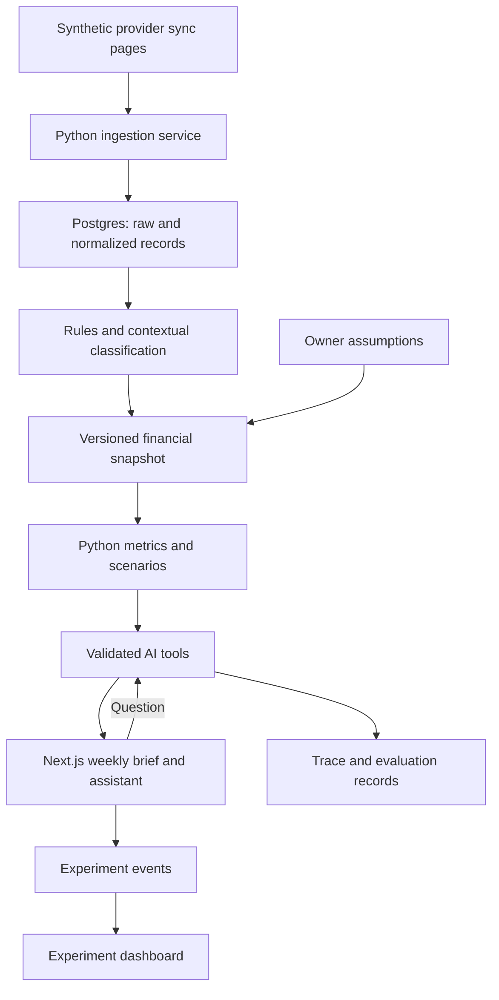
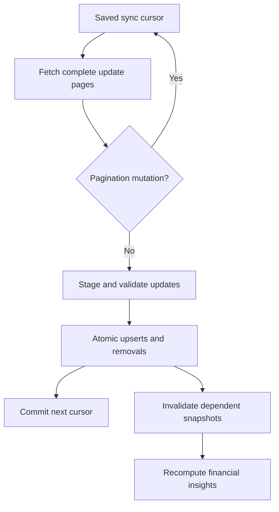
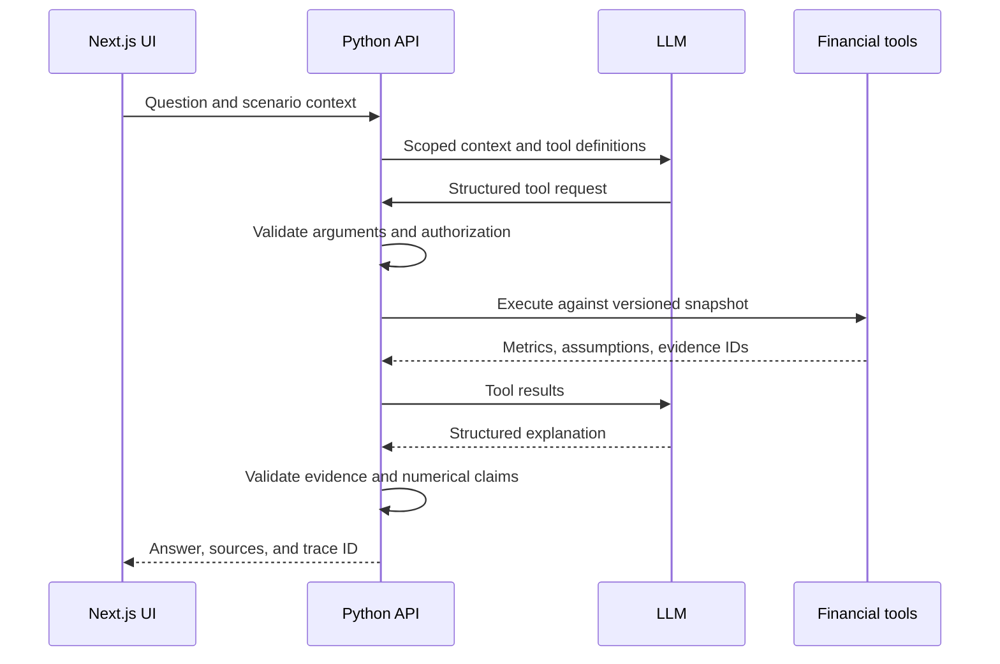

# AI CFO: engineering blueprint

> **CashLens scope update:** Real CSV and supported text-PDF statement uploads are now planned alongside the synthetic demos. Read [CashLens-Statement-Import-Plan.md](CashLens-Statement-Import-Plan.md) first for the revised ownership model, import workflow, schema, security and milestones. It supersedes earlier synthetic-only and anonymous-only assumptions. Existing diagrams show the synthetic baseline; the addendum contains the upload extension. No application implementation is claimed.

> **Repository visibility update (September 12, 2026):** The code repository is one private GitHub monorepo with the application deployed separately to Vercel; reviewer access is shared on request. Earlier wording in this document that called for a public repository was updated in place. A public demo URL does not make the code public. See [ADR 0002](../decisions/0002-private-repository-and-deployment.md).

Status: approved implementation direction; implementation has not started. Updated September 12, 2026.

Revision 2: one private GitHub monorepo (see ADR 0002); Next.js and Python/FastAPI on Vercel; Supabase database; live OpenAI features with server-side credentials. Prove deployment before feature development.

Independent portfolio prototype inspired by a commercial rent-financing team's stated interest in a tenant AI CFO. Working project name: CashLens (not cleared as a commercial brand). Use independent branding; synthetic examples are public, uploaded financial data is private. Do not publish private interview transcripts, company financial disclosures, or personal screenshots in the repository.

## 1. Product contract

Help a small-business owner understand changes in cash and explore upcoming cash pressure from connected bank data. Deliver three fictional businesses, a weekly brief, supporting evidence, a constrained financial assistant, a scenario calculator, and one instrumented layout experiment.

The interview explicitly identifies Plaid-connected bank transactions and an initial contextual classifier. The founders want understandable financial insights for owners. The interview does not prove that every owner lacks a bookkeeper or that no AI CFO implementation exists.

This prototype begins after a fictional bank connection. No real bank credentials, underwriting decisions, payment execution, bookkeeping integration, or recreation of any existing product's application process is required.

## 2. Data boundaries

| Information | Origin | Treatment |
|---|---|---|
| Posted amounts, dates, account IDs, descriptions | Synthetic bank-provider fixtures | Observed within the demo; preserve original records |
| Balance and timestamp | Synthetic account snapshots | Show freshness; do not equate current and available balance |
| Transaction category and recurring pattern | Rules and model inference | Inferred; attach evidence, uncertainty, and version |
| Rent amount and scheduled obligations | Owner-entered demo assumptions | Explicitly confirmed or editable |
| Expected invoice receipt and due date | Owner-entered assumption | Never pretend a bank feed contains unpaid invoices |
| Future sales and settlement timing | Documented baseline plus scenario assumptions | Projection, not an observed fact |
| Profit, inventory, taxes due, supplier unit prices | Not sufficiently available | Do not claim from bank transactions alone |

Use 'operating receipts' and 'supplier payments', not audited revenue or cost of goods sold. Card processor settlements may be net of fees and do not reveal all underlying sales. Bank data does not expose invoice line items. Increased supplier payments can reflect timing, quantity, or price; the assistant must not invent the cause.

## 3. System architecture

Use Next.js (React and TypeScript), Python with FastAPI and Pydantic, and Supabase Postgres with migrations. Keep financial logic and AI orchestration in one modular Python backend. Local Postgres provides reproducible tests. Lock dependency versions when implementing and commit lockfiles.

### Hosting and deployment decision

| Component | Approved choice | Responsibility |
|---|---|---|
| Repository | One private GitHub monorepo (ADR 0002) | Frontend, backend, migrations, tests, diagrams, and authentic commits; reviewer access on request |
| Frontend | Next.js on Vercel | Public demo URL, UI, streaming presentation |
| Backend | FastAPI on Vercel Functions | Financial tools, AI calls, validation, and analytics ingestion |
| Database | Supabase Free | Transactions, snapshots, scenarios, experiment events |
| Model | OpenAI API | Quality-first live classification, briefing, and scenario interpretation |

Replace the previous Vite/GitHub Pages/Render direction. Prefer established deployment paths: two Vercel projects from one repository, with frontend /api requests rewritten to the Python project if appropriate. Confirm routing, streaming, cookies, and authorization in the initial deployment spike. Do not rely on beta multi-service features to meet the interview deadline. The backend still validates every request even when proxied.

Vercel Hobby is intended for personal noncommercial use; revisit hosting terms if the portfolio becomes a commercial product. Supabase Free can pause after inactivity. OpenAI usage is separately billed. Function duration and platform quotas must be verified during setup, especially for higher-reasoning models. Use bounded batches and explicit persisted job status if work must span requests; do not rely on processes continuing after a serverless response.

Deployment gate before feature development: a public Next.js page calls a deployed Python health endpoint, performs a minimal Supabase read/write using server credentials, and completes a bounded OpenAI request. Check streaming through the selected routing path, error handling, and absence of secrets in the client bundle. Health endpoints must not return credentials or trigger model spend. Set up preview and production environment scopes; keep preview analytics separate from real demo results.

### Secrets and public-demo controls

Store the OpenAI key, database password, and privileged Supabase keys only in server-side hosting settings. Never use NEXT_PUBLIC_ variables for secrets. Commit .env.example placeholders; ignore .env files; inspect staged changes and generated bundles for secrets. Credentials must not appear in traces or logs. The browser receives only necessary public configuration and a scoped session.

Use server-enforced per-session and global model-call limits, input/output limits, bounded retries, and a persistent usage budget with atomic reservation before calls. Cache by business, snapshot, prompt/model version, and scenario parameters. Provider dashboard budgets alone must not be assumed to enforce a hard cap. Reviewer fixture resets and regeneration controls require authorization; public users cannot reset shared data or exhaust regeneration quotas. Give visitor-owned scenarios and corrections separate session scope so one visitor cannot alter another visitor's demonstration.

### Decision evidence

Our architecture is an independent choice, not a claim of reproducing theirs.

Support a deterministic replay mode with recorded, clearly labeled AI responses and a live model mode using a server-side key. Live responses must derive from tool results. Report mode visibly in the demo; replay is not evidence of live model performance. A narrow provider interface is enough; implement OpenAI first. Select a current high-quality model available to the user during implementation and configure its ID server-side. Prioritize correctness over minimum token cost, while measuring latency. Cached and replay responses remain distinguishable from fresh inference. Live AI is a release requirement, not an optional cosmetic feature.

## 4. Bank ingestion and money correctness

Design the fixture adapter around Plaid-like incremental updates: added, modified, removed, next cursor, and has_more. These are synthetic fixtures, not a claim of a certified or live Plaid integration.

Implementation requirements:

- Key imported transactions by business, provider, and external transaction ID. Repeated imports must be idempotent.
- Preserve raw provider amounts and normalize to integer minor units, positive for cash inflows and negative for outflows. Verify Plaid's provider sign convention during implementation.
- Apply all sync pages before publishing a new consistent snapshot. On pagination mutation, restart from the original update cursor. Serialize updates per connection.
- Pending and posted records can have different IDs and amounts. Apply removals and pending linkage, rather than adding both amounts. Exclude pending items from historical posted totals.
- Version classifications and preserve owner overrides. Invalidate overrides for review if a modified record materially changes their basis.
- Pair transfers only with sufficient account and transaction evidence. An ambiguous transfer remains unresolved. Neutralize confirmed internal transfers only across the accounts included in the consolidated scope.
- Credit-card purchases are spending evidence, not immediate outflows from checking. Do not count both purchases and card repayment as duplicate expenses. The first scenario can focus on depository accounts; include the credit-card distinction as a tested extension before advertising support.
- Start projections from a dated balance anchor. Prevent overlap between activity already reflected in that anchor and projected obligations. Flag stale or unreconciled data.
- Use USD only in version one. Never sum currencies without explicit conversion support.

## 5. Three businesses and reproducible fixtures

Generate six months of histories with fixed seeds and a frozen demo date. Each case has an opening balance, posted activity, closing balance, data-quality cases, and separate future assumptions. Expected evaluation answers must be inaccessible to application tools and model context.

| Business | History | Owner-supplied future assumptions | Demonstration |
|---|---|---|---|
| Juniper Kitchen | Frequent processor settlements, supplier payments, payroll-like debits | Rent and next payroll dates | Explain supplier-payment change; simulate slower receipts |
| Willow Studio | Appointment-related settlements, subscriptions, equipment outflow | Planned equipment purchase | Separate recurring spending from a one-time purchase |
| Northline Services | Irregular large deposits, materials, warehouse rent | Expected customer receipt and date | Simulate a delayed receipt without claiming to know unpaid invoices |

Add a transfer pair, ambiguous deposit, financing inflow, duplicate import, pending-to-posted change, removed transaction, and stale snapshot across the cases. The labels must not be conveniently embedded in all transaction descriptions. Include genuinely unresolvable examples.

## 6. Financial and AI implementation

### Three required AI capabilities

1. Contextual transaction classification: resolve ambiguous descriptions using business context and recurrence, returning validated categories and evidence. Keep genuinely uncertain items unresolved.
2. Proactive weekly brief: code identifies measurable financial changes; AI produces useful explanations, missing-context questions, and evidence links automatically, before the user starts a conversation.
3. Natural-language scenario execution: AI translates a request into permitted structured parameters, Python computes the scenario, and AI explains results grounded in the returned facts.

Owner clarification closes the loop: user corrects an ambiguous deposit, the override is saved in that visitor's scoped workspace, metrics recompute, and the brief is regenerated or marked stale until ready. Demonstrate this on synthetic data without modifying shared base fixtures.

Each capability has its own prompt version, input/output schema, evaluation cases, and trace. The trace displays execution records and concise evidence-based explanations, not private model chain of thought. Show fresh/cached/replay status, actual model ID, tool arguments, validation outcome, source IDs, latency, and token usage with secrets redacted.

Core backend tools:

- get_cash_summary(period): validated historical metrics and source IDs.
- explain_payment_change(category, periods): comparable-period sums, transactions, and missing-context flags.
- get_upcoming_obligations(): owner-confirmed obligations and inferred recurring payments labeled separately.
- simulate_cash_flow(scenario): daily projected balances, lowest balance, shortfall dates, assumptions, and base snapshot ID.
- get_evidence(reference_ids): only references belonging to the authorized business.

The server derives business scope from the session, not from an LLM argument. Validate amounts, date ranges, scenario duration, and allowed operations. Bound tool iterations, timeouts, and output size. Treat transaction descriptions as untrusted data, including instructions embedded in memos.

Use structured claims referencing computed metric IDs; reject unsupported references and numeric assertions. Reference validation alone cannot establish semantic truth, so include answer evaluation and cautious wording. If generation fails, show the calculated result with a clear unavailable explanation state. Do not silently manufacture a narrative.

A simple forecasting baseline is sufficient: weekday patterns from complete recent weeks, with known recurring obligations removed from residual spending before explicit future obligations are added. Test that payroll and rent are not counted twice. Label low/high projections as assumption scenarios rather than statistical confidence intervals. A rent-split scenario uses illustrative owner-configured schedules and fees, never purported the customer eligibility or pricing.

## 7. User experience

Overview: business selector, data freshness, cash outlook, business insights, and assistant access. Each insight opens an evidence drawer. Scenario results show original assumptions next to changes. Maintain the polished mockup's clarity while reducing emphasis on rent-plan simulation.

Separate developer view: trace viewer, fixture controls, and experiment preview. Experiment toggles must not appear in the normal owner workflow. Switching businesses changes the underlying dataset, not only labels. Isolate saved scenarios and chat state by business.

## 8. One A/B experiment

Hypothesis: placing cash outlook above business insights changes meaningful exploration of financial information.

| A | B |
|---|---|
| Cash outlook, then business insights | Business insights, then cash outlook |

Everything else remains identical. Stable 50/50 assignment per anonymous participant and experiment version. The assignment persists across company selection and sessions within the same browser. Anonymous browser identity is not a verified person and can reset; document this limitation.

Primary outcome: distinct eligible exposed participants opening any insight detail within 24 hours of first exposure, divided by all distinct eligible exposed participants with a completed observation window. Assign exposure when the experiment container renders successfully; per-block visibility is a separate diagnostic and must not redefine the primary denominator.

Secondary outcomes: successful scenario completion, follow-up question, and time to first detail. Diagnostics: block visibility (at least 50% visible for one second), first block opened, company selected, and device size. Quality signals: errors and optional task comprehension. Clicks show engagement, not proven financial understanding.

Event envelope: event_id, participant_id, session_id, experiment_id, version, variant, business_id, event_name, block_id, server_received_at, client_time, mode, snapshot_id. Do not store bank descriptions or chat text in analytics. Deduplicate event IDs; assign trusted variant server-side; use constrained event enums. Exclude replay, staff preview, simulated traffic, and automated tests from real results.

Dashboard: sample counts, primary conversion, secondary events, absolute difference, uncertainty, and assignment imbalance. Show insufficient evidence at low sample sizes. Do not stop automatically when a result looks favorable. After a real baseline exists, predefine duration and minimum detectable effect; generated traffic cannot establish a winner.

## 9. Minimal data model

| Entity | Essential content |
|---|---|
| businesses / memberships | Profile and authorization scope |
| connections / accounts | Provider IDs, sync cursor, account type, currency |
| sync_batches / raw_events | Replay history and status |
| transactions | Source IDs, amount, date, status, pending link |
| balance_snapshots | Amount type, timestamp, account |
| classifications / overrides | Category, method, evidence, version |
| obligations / assumptions | Value, origin, date, owner confirmation |
| financial_snapshots / scenarios | Input versions, calculation version, result |
| ai_runs | Provider, model, prompt version, tools, latency, cost, validation |
| assignments / analytics_events | Experiment identity, variant, event, mode |

Add foreign keys and business-scoped indexes. Protect tenant data in API queries and database policies where applicable. Test cross-business access attempts and keep database service keys off the client.

## 10. Build order and genuine commit milestones

The sequence is a plan, not a fabricated history. Commit as work is completed. Actual fixes and changed decisions belong in the history. Do not backdate commits.

| Stage | Suggested commit | Reviewable result / completion gate |
|---|---|---|
| 0 | docs: define bank-data scope and architecture | This blueprint, key assumptions, repository boundaries |
| 1 | chore: scaffold Next.js and FastAPI services | Local health checks, environment example, dependency locks, CI |
| 1a | deploy: verify Vercel and Supabase integration | Public frontend, Python API, database connectivity, streaming, and bounded OpenAI call; no client secrets |
| 2 | feat: add bank schema and seeded businesses | Migrations and reproducible fixtures; balances reconcile |
| 3 | feat: ingest incremental transaction updates | Added/modified/removed replay; idempotency and pending tests pass |
| 4 | feat: calculate cash metrics and scenarios | Financial tests pass before adding model-generated explanations |
| 5 | feat: classify ambiguous transactions with evidence | Rule baseline, one live model adapter, separate evaluation results |
| 6 | feat: generate proactive financial briefs | Measured signals, validated explanations, evidence links, freshness handling |
| 6a | feat: execute CFO scenarios through AI tools | Working tool calls, validated parameters, financial calculations, failure handling, isolation |
| 7 | feat: build overview and evidence interactions | Three businesses, saved scenarios, loading/error states, responsive UI |
| 8 | feat: instrument layout experiment | Persistent assignment, visibility, unique events, preview exclusion |
| 9 | feat: add experiment and trace views | Traceable answers, honest sample counts, simulated/real separation |
| 10 | docs: document evaluation and demo walkthrough | Actual results, screenshots, setup verification, limitations, demo script |

The technical interview is expected this week; its exact date is not yet supplied. Target four focused build days plus rehearsal, but re-estimate after the first deployment gate. Day 1: foundation and deployed connectivity. Day 2: datasets, ingestion, and financial correctness. Day 3: the three AI capabilities and integrated UI. Day 4: experiment instrumentation, evaluation, documentation, and rehearsal. These are targets, not completed milestones or guarantees. Ship the complete workflow before optional integrations. Live Plaid Sandbox, actual bank connections, multiple model providers, invoice uploads, payments, and model training are later work. Bank statement uploads are now in scope under the statement-import addendum; invoice uploads remain out of scope.

## 11. Repository and supporting documentation

Proposed folders: apps/web (Next.js), services/api (FastAPI), db/migrations, fixtures/provider, evals, tests, docs/decisions, docs/diagrams, and .github/workflows. Use one private repository for all code and documentation, deployed separately to Vercel; a separate hosting repository is unnecessary. Share repository access with reviewers only on request. Commit deployment configuration without credential values.

README: purpose, screenshot, five-minute walkthrough, quick start, architecture, synthetic/live mode, evaluation summary, limitations. Supporting documents: data-contract.md, financial-definitions.md, experiment-design.md, evaluation.md, and short architecture decisions recording options, choice, and consequence.

CI runs formatting/type checks, unit tests, database integration tests, frontend build, and one end-to-end scenario. Do not require a paid model key in normal CI; keep live model evaluations separate and explicitly invoked. Keep fixtures small enough to inspect. Pin prompt and fixture versions in evaluation output.

## 12. Acceptance and evaluation

- Importing the same update twice leaves metrics unchanged.
- Pending-to-posted replacement counts the final posted amount once.
- Modified and removed records invalidate stale insights.
- No cross-business queries, scenario leakage, or evidence access.
- Confirmed internal transfers and financing do not inflate operating receipts.
- Recurring forecasts do not duplicate explicit obligations.
- Money arithmetic uses minor units; invalid dates and unsupported currencies fail clearly.
- Known-answer assistant cases verify tool selection, source validity, numeric correctness, uncertainty, and provider failure behavior.
- Transaction memo prompt injection cannot change tool permissions or access other businesses.
- Report classification accuracy, unresolved rate, and amount-weighted errors on held-out synthetic cases; no claims of production validation.
- Record measured latency and cost only for actual live runs.
- Experiment tests cover stable assignment, refreshes, duplicates, visibility, immature windows, and preview exclusion.
- Public deployment acceptance: fresh OpenAI calls work for all three AI capabilities, cached results are labeled, streaming/errors render correctly, and credentials are absent from browser assets and public traces.
- Validate visitor isolation, persistent budget enforcement, and environment separation.
- One end-to-end test: select a business, open evidence, ask a question, run a delayed-receipt scenario, inspect trace, observe the correct experiment events.

## 13. Interview walkthrough

1. Open the live URL, explain bank-data limitations, and show a proactively generated fictional weekly brief.
2. Open an insight and trace it to transactions.
3. Ask why cash increased despite weaker operating receipts; distinguish transfers/financing.
4. Delay an owner-entered expected receipt; show recalculated daily cash and assumptions.
5. Show the validated tool trace and one meaningful test.
6. Preview both layout variants and explain why there is no claimed A/B winner yet.

## Sources and implementation references

- Interview transcript supplied privately by the user: Plaid, contextual classification, AI CFO direction, React/Python/Supabase, and rapid iteration. Keep transcript out of the repository regardless of its visibility.
- [Plaid transaction state behavior](https://plaid.com/docs/transactions/transactions-data/)
- [Plaid incremental transactions API](https://plaid.com/docs/api/products/transactions/)
- [Plaid balance concepts](https://plaid.com/docs/balance/)
- [Vercel Python runtime](https://vercel.com/docs/functions/runtimes/python)
- [Vercel Hobby plan](https://vercel.com/docs/plans/hobby)
- [Supabase pricing](https://supabase.com/pricing)

No GitHub repository, running application, or deployed demo has been created as part of this blueprint. This document is the implementation starting point.
