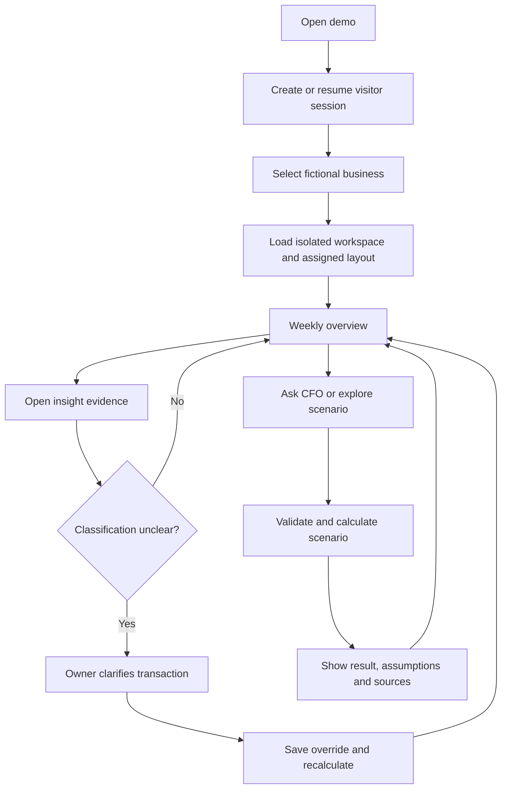
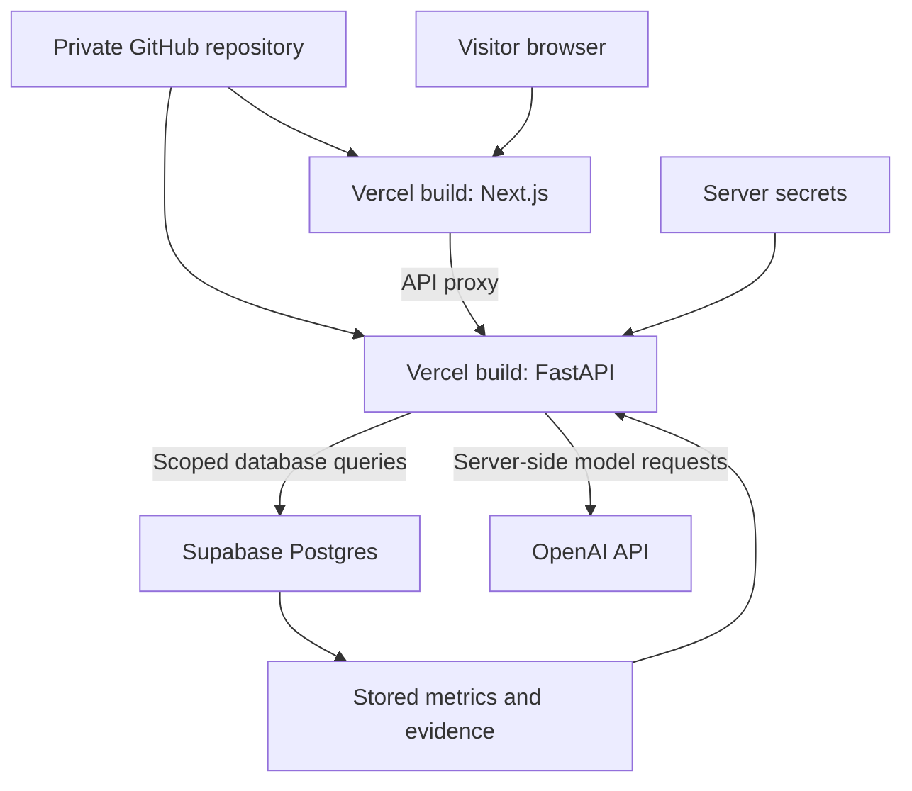
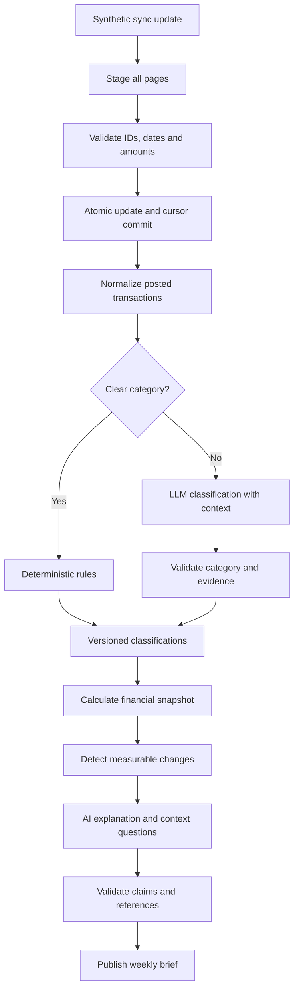
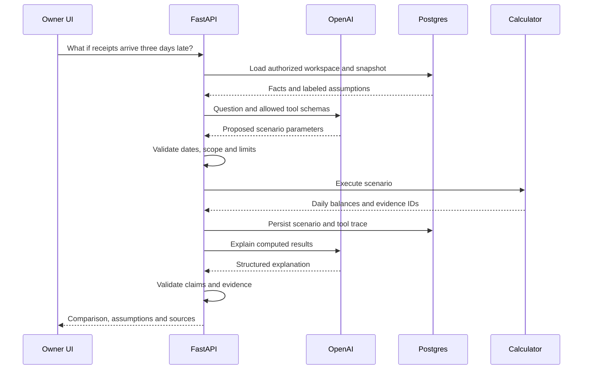
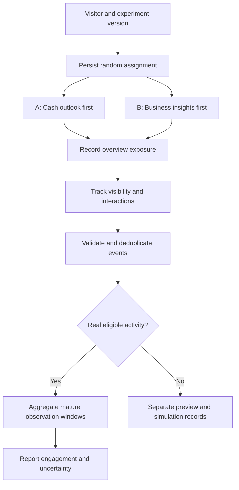
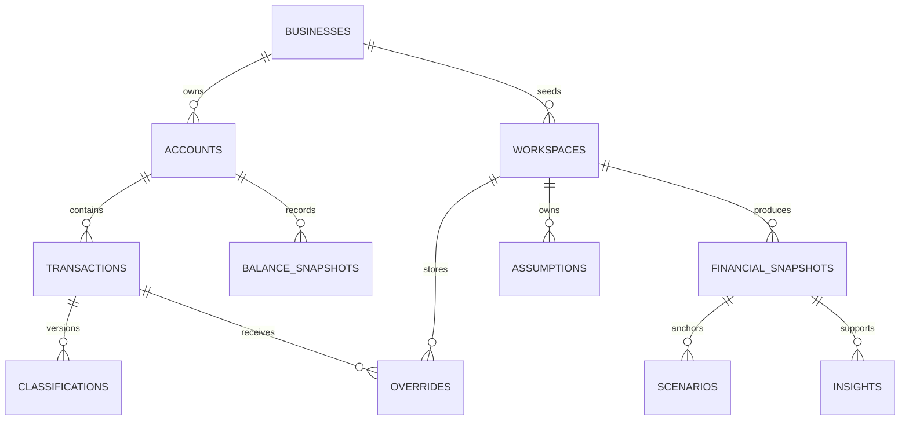
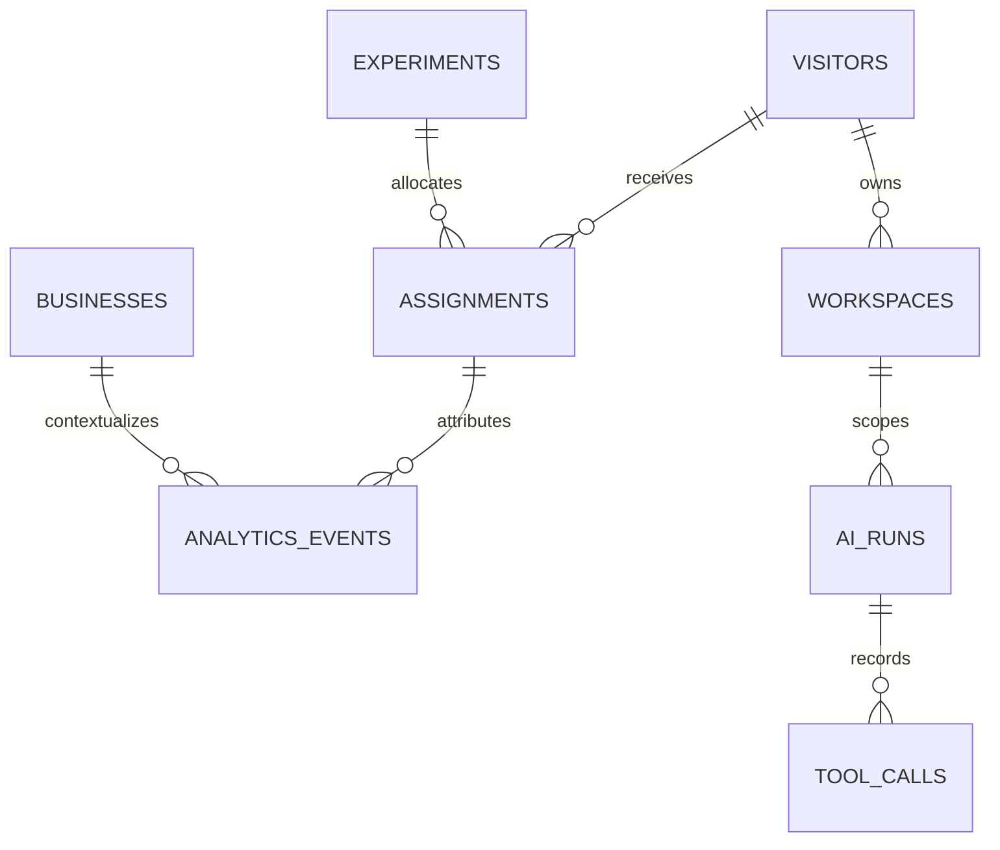

# AI CFO: flows and data relationships

> **CashLens scope update:** Real CSV and supported text-PDF statement uploads are now planned alongside the synthetic demos. Read [CashLens-Statement-Import-Plan.md](CashLens-Statement-Import-Plan.md) first for the revised ownership model, import workflow, schema, security and milestones. It supersedes earlier synthetic-only and anonymous-only assumptions. Existing diagrams show the synthetic baseline; the addendum contains the upload extension. No application implementation is claimed.

> **Repository visibility update (September 12, 2026):** The code repository is one private GitHub monorepo with the application deployed separately to Vercel; reviewer access is shared on request. Earlier wording in this document that called for a public repository was updated in place. A public demo URL does not make the code public. See [ADR 0002](../decisions/0002-private-repository-and-deployment.md).

Design companion to AI-CFO-Engineering-Blueprint.md. September 12, 2026. Proposed architecture, not an implemented system. Independent concept using synthetic bank data.

## 1. User flow

Visitor-specific workspaces protect shared seed data. Changing businesses preserves the same experiment assignment but selects a different financial workspace. An anonymous visitor can access only the workspaces granted to their session.

## 2. Deployment and trust boundaries

The browser receives no OpenAI key, database password, or privileged Supabase key. A public API still enforces session scope and usage limits. Frontend proxying is not authentication. Keep preview and production analytics separate. Validate the two-project Vercel routing configuration in the first deployment milestone. The code repository is private; a public demo URL does not change that (see [ADR 0002](../decisions/0002-private-repository-and-deployment.md)).

## 3. Bank feed to proactive AI brief

Unresolvable classifications remain uncertain. No model calls while holding the ingestion database transaction open. Model processing uses committed inputs. Corrections invalidate dependent metrics and briefs; the UI shows stale or processing status rather than silently mixing versions.

## 4. Scenario execution sequence

If the request could refer to several expected receipts, ask which one instead of choosing silently. Scenario changes never move money. Calculation failure returns a clear error; model failure can still display valid computed results without a fabricated explanation.

## 5. A/B experiment flow

Same content and functionality in both layouts. One assignment persists across all three business selections. Primary metric: unique exposed visitors opening an insight detail within 24 hours, divided by eligible exposed visitors whose 24-hour window is complete. Block visibility is a diagnostic, not a treatment-dependent primary denominator. Company, device, and event mode are recorded. No automatic winner from generated traffic or a small interview audience.

## 6. Core financial relationships

Each workspace belongs to one visitor and one fictional business. Bank fixtures and baseline classifications are shared read-only; overrides, assumptions, snapshots, and scenarios are workspace-scoped. A real product would replace this demo ownership model with authenticated organizations and memberships.

### Table definitions

| Table | Primary key | Foreign keys | Important fields and rules |
|---|---|---|---|
| businesses | id | none | name, industry, currency; three fictional seed businesses |
| visitors | id | none | created_at; opaque session identity, not a verified person |
| workspaces | id | visitor_id, business_id | revision; unique visitor/business pair |
| connections | id | business_id | provider, external_item_id, sync_cursor, status |
| sync_batches | id | connection_id | start/end cursor, status; atomic application |
| raw_events | id | sync_batch_id | operation, external_transaction_id, payload; preserved lineage |
| accounts | id | business_id, connection_id | external_account_id, account_type, currency |
| transactions | id | account_id, business_id | external_id, signed_amount_minor, date, pending, removed_at, pending_transaction_id, revision |
| balance_snapshots | id | account_id | current_minor, available_minor, as_of; nullable available balance |
| classifications | id | transaction_id, ai_run_id nullable | category, method, evidence, transaction_revision, prompt_version; immutable history |
| overrides | id | workspace_id, transaction_id | category, reason, source_revision, created_at; append-only history |
| assumptions | id | workspace_id | kind, amount_minor, due_date, origin, confirmation, revision |
| financial_snapshots | id | workspace_id | data_revision, assumptions_revision, calculation_version, as_of, metrics, status |
| scenarios | id | workspace_id, financial_snapshot_id | validated parameters, projected balances, status, created_at |
| insights | id | financial_snapshot_id, ai_run_id nullable | type, structured_claims, explanation, status |
| insight_transactions | insight_id + transaction_id | insight_id, transaction_id | source_revision; many-to-many evidence join |
| ai_runs | id | workspace_id | capability, model, prompt_version, mode, tokens, latency, validation_status |
| tool_calls | id | ai_run_id, snapshot_id nullable, scenario_id nullable | tool, validated_args, safe_result, sequence, status |

Application enums: category, assumption origin, processing status, AI capability, and event name. Currency is USD in the first version. Store money as integer minor units. Validate date ranges. Use composite foreign keys or equivalent enforced checks to ensure linked records belong to the same business/workspace. A guessed valid ID from another workspace must not grant access.

An insight can reference several transactions and a transaction can support several insights, hence the evidence join table. A financial snapshot records the exact input revisions; seed revisions remain available for replay. If classified inputs change, an old snapshot stays historical while a new snapshot is computed.

## 7. Experiment and trace relationships

| Table | Key relationships | Constraints and purpose |
|---|---|---|
| experiments | id; experiment_key + version unique | status, allocation, metrics, observation window |
| assignments | visitor_id, experiment_id | unique visitor/experiment; immutable variant |
| analytics_events | assignment_id, business_id | unique event_id; event_name, block_id, session_id, received_at, client_time, mode, environment |
| usage_reservations | visitor_id, ai_run_id nullable | reserve budget atomically before paid work; state and token ceiling |

Store the variant on the assignment. If copied into an event for reporting, validate it against the assignment server-side. Do not trust a client-supplied variant. Distinguish cache from replay: cache can be part of a real user experience, while replay/testing is excluded by the experiment eligibility rules. Do not include financial descriptions or question text in analytics events.

## 8. Data example: one clarification

| Stage | Record or action | Effect |
|---|---|---|
| Bank input | Transaction t_104, positive 120000 minor units | A $1,200 deposit is observed |
| Classification | Ambiguous category, transaction revision 1 | Deposit is not silently treated as operating receipts |
| Owner input | Workspace-scoped override: internal transfer | Only this visitor's workspace changes |
| Recalculation | Snapshot s_8 supersedes s_7 for current display | Operating-receipt metrics reflect new classification |
| AI brief | New insight tied to s_8 and t_104 | Explanation shows the owner confirmation as evidence |
| Other visitor | Separate workspace | Original ambiguity remains intact |

## 9. Visual direction

The concept mockup uses a set of reference screenshots as visual guidance: white backgrounds, rounded white cards, faint shadows, near-black rounded sans-serif headings, vivid purple primary actions, lavender secondary surfaces, and purple outlined selections. It uses neutral Business CFO branding and an Independent concept label.

| Surface | Layout | Key interaction |
|---|---|---|
| Overview | Three business chips, two stacked information blocks, CFO side panel | Open an insight or start a scenario |
| Evidence drawer | Explanation, source transactions, uncertainty, owner clarification | Save a correction |
| Scenario view | Baseline and changed assumptions alongside daily balances | Recalculate and save |
| Technical view | Capability traces and separate experiment panel | Inspect tools and preview variants |

The overview has one business selector in implementation; any duplicate selector in a generated mockup is decorative and should be removed. Sample image copy and values are illustrative, not evaluated financial output. Replace mockup wording with 'Upcoming payments may fall due before customer receipts arrive.' The A/B variant changes only the order of Cash outlook and This week's insights. Keep all other text, appearance, and functionality identical.

## 10. Build checkpoints

1. Commit the design and data contract.
2. Scaffold Next.js, FastAPI, migrations, and CI.
3. Verify deployed frontend/API/Supabase/OpenAI connectivity with server secrets.
4. Build consistent fixtures and ingestion with idempotency tests.
5. Implement financial metrics and scenarios with known-answer tests.
6. Add classification, proactive briefs, and tool-driven scenarios with measured evaluation.
7. Complete UI, evidence, visitor isolation, and corrections.
8. Add the single layout experiment and validate instrumentation.
9. Capture actual application screenshots, finalize README, and rehearse the traced walkthrough.

All diagrams describe intended behavior. No completed implementation or deployment is claimed by this design document.
