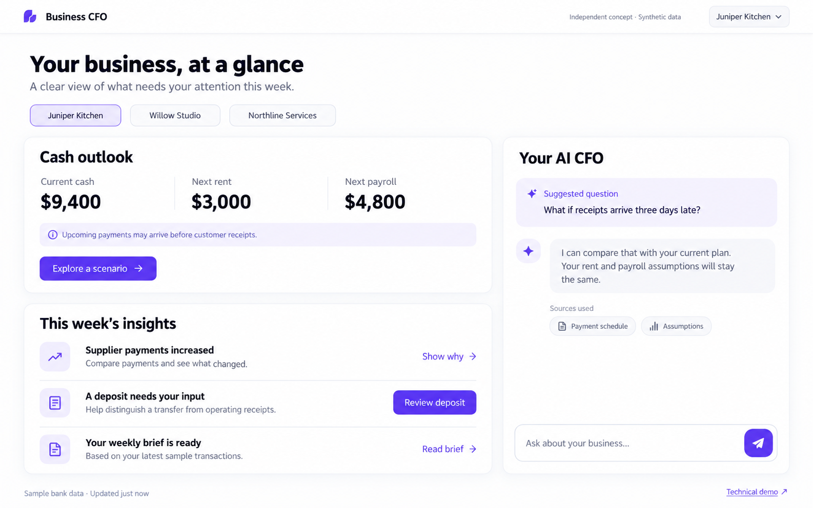
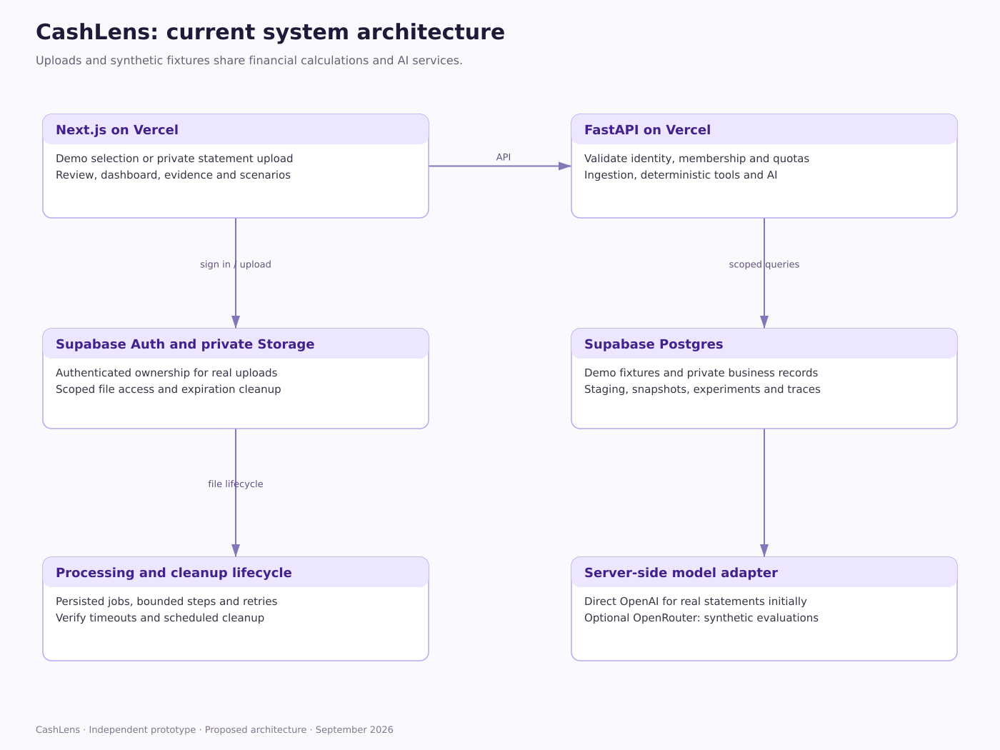

# AI CFO: development playbook

> **CashLens scope update:** Real CSV and supported text-PDF statement uploads are now planned alongside the synthetic demos. Read [CashLens-Statement-Import-Plan.md](CashLens-Statement-Import-Plan.md) first for the revised ownership model, import workflow, schema, security and milestones. It supersedes earlier synthetic-only and anonymous-only assumptions. Existing diagrams show the synthetic baseline; the addendum contains the upload extension. No application implementation is claimed.

> **Repository visibility update (September 12, 2026):** The code repository is one private GitHub monorepo with the application deployed separately to Vercel; reviewer access is shared on request. Earlier wording in this document that called for a public repository was updated in place. A public demo URL does not make the code public. See [ADR 0002](../decisions/0002-private-repository-and-deployment.md).


For Clayton. Planning handoff for VS Code. September 12, 2026.

## Intended outcome

One private GitHub monorepo (see ADR 0002), live Next.js frontend and FastAPI backend on Vercel, Supabase Postgres, and real server-side OpenAI integration. Three fictional businesses, contextual classification, proactive CFO briefs, scenario tool calls, and one layout-order A/B experiment. OpenAI powers the product at runtime.

Inputs: AI-CFO-Engineering-Blueprint.md, AI-CFO-Flows-and-Data-Model.md, and the approved purple/white dashboard mockup. The documents are proposed architecture, not evidence that code exists.

## 1. High-level implementation

Build an early deployed vertical slice, then strengthen it. Begin with one business through import, metrics, brief, and scenario. Add the other two distinct datasets after that path works. The delivered scope still includes all three businesses.

Use apps/web for Next.js and services/api for FastAPI. Put all authoritative calculations and AI orchestration in Python. Next.js presents information and forwards API requests; do not maintain duplicate financial logic in TypeScript. Supabase stores immutable seed data, visitor workspaces, revisions, scenarios, AI traces, and experiment events. Use a small database migration tool chosen during setup, and commit its configuration.

Avoid feature sprawl: no actual bank connections, payment execution, credit approvals, invoice OCR, multi-agent orchestration, or real financial advice. Model identifiers are configuration, selected from models actually available to the user's API account during implementation.

## 2. README visual assets

Repository paths, as shipped in this repository (corrected September 12, 2026 from an earlier docs/images and docs/diagrams/system.svg layout that was never created):

- docs/mockups/cfo-overview-concept.png: original generated mockup, labeled concept.
- docs/screenshots/cfo-overview-live.png: actual application screenshot, added only once it exists; the folder is created at that time.
- docs/diagrams/08-current-system.svg and .png: current system architecture.
- docs/diagrams/09-statement-upload.svg and .png: statement upload workflow.
- docs/diagrams/10-private-data-model.svg and .png: private import relationships.
- docs/diagrams/11-import-jobs-and-ai.svg and .png: import processing and AI relationships.
- docs/diagrams/upload-user-flow.mmd, upload-system-flow.mmd and private-import-relationships.mmd: editable Mermaid sources for the current set.
- docs/diagrams/baseline/01-system through 07-database-experiments (.svg and .png) with editable-flow-01 to 07.mmd: the synthetic baseline covering system, bank-to-brief, scenario, A/B experiment and the three database drawings. Per docs/diagrams/README.md these describe synthetic demo mode and are superseded for ownership and provenance by the statement import plan.
- scripts/render_current_diagrams.py: renders the current set (08-11) from a Python layout, not a Mermaid export.

The concept image is already in docs/mockups; do not put private interview screenshots in repository assets. Mermaid files are the editable logical sources and the SVG/PNG drawings are rendered separately, so update both when a relationship changes. Validate renders by viewing them; long diagrams may need splitting for legibility.

README image examples (relative paths so GitHub renders them):

```markdown
## Initial interface concept



## Current architecture



[All diagrams and baseline scope notes](../diagrams/README.md)
```

README order: purpose and current status; live demo link when available; actual screenshot when available; original concept labeled clearly; architecture; data model; one end-to-end request flow; local setup; evaluation; A/B experiment; limitations; development decisions. Keep dense schema details in docs/data-contract.md. Do not claim design artifacts prove development chronology; real commits provide that history.

## 3. Working method

Work one milestone at a time. Inspect existing instructions and code before editing. Review the diff and run the targeted checks before committing. Use actual dates, actual results, and actual changes. Do not split finished code after the fact to simulate a process or fabricate failures. If a milestone needs two meaningful commits, that is fine.

Create concise issues or a checklist for milestones. Use short-lived feature branches and descriptive PRs where useful; one-person development does not need a PR for every trivial edit. Protect main from known failing changes. Authorize git commits, pushes, and deployment explicitly for each milestone.

Commit body format: why this change was needed; what changed; what was verified; known limitation if material. Commit messages carry no authorship or tooling notes. Only claim review actually performed.

## 4. Initial milestone brief

Read this with the blueprint, data-model document, and mockup available locally:

```text
We are building an independent AI CFO portfolio prototype. Read the project instructions, AI-CFO-Engineering-Blueprint.md, and AI-CFO-Flows-and-Data-Model.md before coding. The agreed stack is Next.js/TypeScript, Python/FastAPI, Supabase Postgres, and server-side OpenAI, with deployment on Vercel from one private GitHub monorepo.

The app uses synthetic Plaid-like bank records for three businesses. It must demonstrate contextual classification, proactive evidence-backed briefs, and validated natural-language scenario execution. Implement one A/B experiment that swaps cash outlook and business insights without changing their content.

For now, complete milestone 0 only. Do not build all milestones at once. Treat these documents as a design to implement, not completed work. Explain any necessary departure. Keep secrets, private interview notes, personal screenshots, and financial disclosures out of this repository. Never place API keys in source files or notes; identify the local or hosting setting that needs them.

At each milestone report changed files, checks actually run, remaining limitations, and a proposed commit message. Stop at the milestone boundary for my code review. Do not claim testing, deployment, or model calls that have not happened. Keep commits truthful and do not backdate history. Avoid unnecessary frameworks and abstractions.
```

## 5. Milestones, briefs, and commits

### 0. Record design and repository structure

Commit: `docs: define bank-data CFO scope and architecture`

Deliverable: public-safe README, design docs, diagram sources and SVGs, concept image, decisions log, milestone checklist, .gitignore. No application implementation yet. Repo name is `cashlens`; this is a descriptive repository name, not a trademark claim.

```text
Complete milestone 0. Create the public-safe documentation structure described in the playbook. Consolidate the supplied plans into concise docs without publishing interview transcripts or private company information. Add the approved mockup as a concept image if it is available; otherwise state the missing asset and do not invent a screenshot. Extract editable Mermaid sources and render corresponding SVG diagrams. Include system, data model, bank-to-brief, scenario sequence, and experiment flows. Make README images render using relative paths. Record the key decisions and current implementation status accurately. Validate diagram readability and links. Propose the commit after showing the diff summary.
```

Review: README renders; diagrams are readable; source files match exports; no sensitive content; status says design-only.

### 1. Scaffold a runnable foundation

Commit: `chore: scaffold Next.js and FastAPI with local checks`

```text
Complete milestone 1 only. Build apps/web with Next.js/TypeScript and services/api with FastAPI/Pydantic. Add a Python health endpoint and a minimal frontend showing API connection status. Choose compatible supported dependencies from official documentation and pin versions with lockfiles. Add environment examples, local start commands, a migration framework, and minimal CI for frontend build/type checks and backend tests. Keep authoritative business logic in Python. Use a lightweight modular backend. No financial features or AI UI yet. Verify the local frontend can call the API and that failures produce a useful error state.
```

Review: clean install, health endpoint, working local UI/API route, CI configuration, no secrets or unnecessary dependencies.

### 2. Prove deployment immediately

Commit: `deploy: connect Vercel services and Supabase`

```text
Complete milestone 2. Prepare and, where my account access authorizes it, deploy the frontend and Python backend to Vercel from this repository, with Supabase as the database. Prefer established two-project deployment with an appropriate API rewrite over beta platform features. Verify current Python runtime and request-duration constraints from official docs. Add a minimal database connectivity check and a protected bounded OpenAI smoke test. Health endpoints must not invoke the model or reveal secrets. Verify streaming through the chosen route, session handling, preview/production separation, and safe errors. Keep OpenAI and privileged database credentials server-side. Tell me exactly which dashboard settings require my action if access is unavailable. Do not claim a live URL until verified. Do not start financial feature work until the deployment limitation is resolved or documented explicitly.
```

Review: visit live frontend; successful Python call; DB operation; bounded model call; stream handling; no secrets in browser requests/assets. No access means a documented blocker, not pretend deployment.

### 3. Create the schema and first bank dataset

Commit: `feat: add scoped workspaces and reproducible bank fixtures`

```text
Complete milestone 3 with Juniper Kitchen first. Implement migrations for the minimum entities required for accounts, immutable source transactions, balance snapshots, visitor workspaces, classifications, assumptions, and financial snapshots. Add reproducible six-month fixtures using a fixed random seed and frozen demo date. Model Plaid-like added/modified/removed pages separately from expected evaluation labels. Ensure signed amounts, opening and closing balances reconcile. Add observed/inferred/owner-confirmed/projected provenance. Seed transfers, financing, ambiguous descriptions, and a pending-to-posted case. Expected answers must remain outside application/model context. Implement authorized visitor workspace selection and test that one visitor cannot access another's mutable records.
```

Review: migrations from empty DB; reproducible seeds; balance reconciliation; isolation tests; assumptions distinguished from bank facts.

### 4. Implement robust transaction updates

Commit: `feat: reconcile incremental bank transaction updates`

```text
Complete milestone 4. Implement the fixture-backed provider adapter and incremental ingestion. Apply added, modified, and removed records atomically across a complete update, persist the cursor only after success, serialize updates per connection, and handle replay safely. Follow documented pending-to-posted semantics and verify provider amount sign conventions. Preserve raw lineage and normalized integer-minor-unit values. Exclude pending records from posted historical totals. Invalidate affected financial snapshots. Test duplicate delivery, record modification/removal, differing pending/posted amounts, pagination restart, and failed transaction rollback. Do not call an LLM while holding an ingestion database transaction open.
```

Review: replay leaves totals unchanged; no duplicated posted spend; rollback retains cursor; changed records invalidate results.

### 5. Build financial tools without narrative generation

Commit: `feat: calculate cash metrics and reproducible scenarios`

```text
Complete milestone 5. Implement get_cash_summary, explain_payment_change, get_upcoming_obligations, simulate_cash_flow, and scoped get_evidence. Exclude confirmed internal transfers and financing from operating receipts, preserve unknown categories, and use dated balance anchors. Model future obligations and receipts from explicit assumptions. Use a simple documented baseline and prevent recurring spending from duplicating scheduled obligations. Return versioned structured results with metric and source IDs. Write meaningful known-answer tests for cash arithmetic, date shifts, repeated obligations, invalid parameters, stale data, and cross-workspace access. Do not infer unpaid invoices, supplier unit prices, or accounting profit from bank records. Implement the core path before expanding optional account types.
```

Review: independently check a worked example; shifting receipts changes dates but preserves amounts; sources and assumptions are inspectable.

### 6. Add contextual classification and owner correction

Commit: `feat: classify ambiguous transactions with grounded evidence`

```text
Complete milestone 6. Add deterministic rules for clear cases and a real server-side OpenAI classifier for ambiguous transactions. Use business context and relevant recurrence/neighbor records, with a constrained schema, allowed categories, evidence references, and unresolved status. Preserve versioned owner overrides in the visitor workspace and recompute dependent metrics after correction. Add prompt-injection and malformed-output cases, bounded retries, provider timeouts, persistent usage reservations, and cache keys scoped to inputs/model/prompt version. Evaluate against held-out synthetic labels and report actual accuracy, unresolved rate, and amount-weighted errors, separately for rules and AI. Do not represent model confidence as a calibrated probability. Prove at least one fresh live call if credentials are available.
```

Review: inspect one live request/output; ambiguous case can stay unresolved; correction updates only the authorized visitor's view; evaluation reports real results.

### 7. Generate proactive CFO briefs

Commit: `feat: generate evidence-backed weekly financial briefs`

```text
Complete milestone 7. Code should detect measurable financial changes and upcoming cash pressure, then OpenAI should explain those signals proactively, before any chat question. Generate structured claims tied to calculated metric IDs and transaction references. Validate numerical values and evidence membership; add evaluation for unsupported semantic claims. Distinguish supplier-payment increases from unknown causes. Ask for owner clarification when needed. Show snapshot freshness and mark a brief stale after data changes. If generation fails, show valid calculated facts with an explicit unavailable explanation. Add capability-specific prompt version, model ID, usage, latency, mode, and validation status to safe traces. Do not expose private chain of thought or credentials.
```

Review: useful insights exist without chat; every numeric claim is traceable; no invented causes; corrections invalidate and refresh briefs.

### 8. Execute natural-language scenarios

Commit: `feat: execute CFO scenarios through validated AI tools`

```text
Complete milestone 8. Add natural-language scenario requests using the existing financial tools. The model proposes structured parameters; the server enforces workspace scope, tool allowlists, date/amount limits, and a bounded call loop. Ask a clarifying question if several expected receipts could match. Persist scenario assumptions, snapshot versions, results, and safe tool traces. Stream status and explanations where supported, but never display unvalidated financial claims as final. Handle provider failure with calculated results where available. Test tool selection, schema rejection, ambiguous requests, isolation, repeat submissions, and correct scenario arithmetic. Keep calculations in Python.
```

Review: ask a new variation, not just a canned question; compare tool arguments to intent; inspect saved scenario and failure behavior.

### 9. Finish the UI and all three businesses

Commit: `feat: complete CFO workspace for three business scenarios`

```text
Complete milestone 9. Implement the approved purple/white concept in Next.js, using one business selector, cash outlook, business insights, evidence drawer, owner correction, scenario comparison, and assistant. Use neutral branding and an independent synthetic-demo label. Add Willow Studio and Northline Services with distinct reconciled six-month histories and explicit future assumptions. Business changes must drive different calculations, insights, and tools, not cosmetic numbers. Handle responsive layout, keyboard access, loading, stale data, empty data, and failures. Reuse the same block components for both experiment variants. Add a technical trace view exposing safe execution evidence only. Visually inspect desktop and mobile views. Capture actual screenshots after verification.
```

Review: each business tells a different financial story; UI is readable; no shared mutable state; all promised AI functions actually work.

### 10. Add the single A/B experiment

Commit: `feat: instrument persistent overview layout experiment`

```text
Complete milestone 10. Implement stable server-recorded 50/50 assignment for cash-outlook-first versus business-insights-first. Keep content and behavior identical. Record overview exposure, block visibility, detail openings, successful scenarios, and follow-up questions using validated deduplicated events. Assignment persists across companies and visits in the same browser. Use the primary metric and mature 24-hour observation window defined in the design; block visibility must not redefine the denominator. Separate actual visitor activity from preview, automation, and generated traffic. Protect preview controls and exclude their events. Store no financial descriptions or chat content in analytics. Test persistence, refreshes, duplicates, event spoofing, observation windows, and preview exclusion.
```

Review: swap order only; real actions emit valid events; repeated delivery doesn't inflate counts; preview doesn't contaminate results.

### 11. Reporting, release, and interview preparation

Commits: `feat: report experiment outcomes and AI execution traces`, then `docs: publish verified demo walkthrough and evaluation`

```text
Complete milestone 11. Build a compact experiment view with exposed participant counts, eligible completed windows, primary conversion, secondary actions, quality checks, uncertainty, and clear insufficient-evidence status. Keep synthetic traffic separate and do not invent a winner. Complete end-to-end verification across the deployed path, checking all three AI capabilities, business isolation, budget controls, source links, and failure states. Run only tests needed for actual remaining risks. Update README with the verified URL, actual screenshots, rendered architecture/data/sequence diagrams, local setup, model configuration placeholders, measured evaluation, and limitations. Record what remains incomplete. Prepare a five-minute demo script and a concise code-tour guide pointing to the financial calculator, classifier, validation, and experiment code. Do not claim results beyond tests actually run.
```

Review: fresh visitor can open the deployed demo; README links work; documented setup is reproducible; no secrets; synthetic results clearly marked.

## 6. Milestone review brief

Use before committing substantial changes:

```text
Review this milestone's diff against the agreed scope. Identify specific correctness, isolation, secret-handling, financial-data, or deployment issues. Check whether tests validate behavior rather than mirror implementation. Fix material issues, run the targeted checks, and list actual results. Explain one meaningful design trade-off and any remaining limitation. Show the intended commit files and message. Do not broaden scope or invent passing results.
```

## 7. Deadline control

First priority is a live deployed end-to-end path. Keep four focused build days plus rehearsal as a target, not a promise. If time is short, simplify dashboard polish, trace filtering, and sophisticated forecasting before cutting real AI behavior or correctness. Retain three businesses, the one layout experiment, and evidence-backed calculations. Never replace live AI with undisclosed fixed responses to claim completion.

Avoid spending the interview explaining infrastructure configuration. Demonstrate business question -> data -> tool -> calculation -> answer -> evidence. Know the source files well enough to explain how a correction changes the next result.

## 8. Author's checkpoints

- Before coding: understand the data boundaries and read the diagrams.
- After ingestion: explain exactly why replay and pending-to-posted transitions don't duplicate cash.
- After metrics: manually verify one business's balances and scenario.
- After AI: inspect a successful case, uncertain case, and failed case.
- After A/B: explain assignment, exposure, denominator, and why clicks are not proof of understanding.
- Before interview: open the live app in a fresh browser session and walk through the repo.

This playbook creates no actual commits, source repository, or application. Commit titles describe the intended future milestones.
