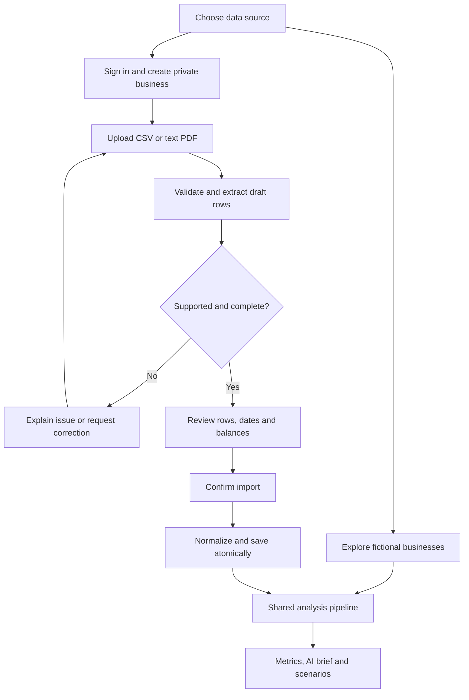
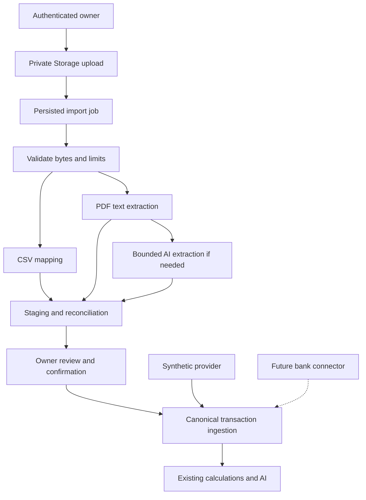
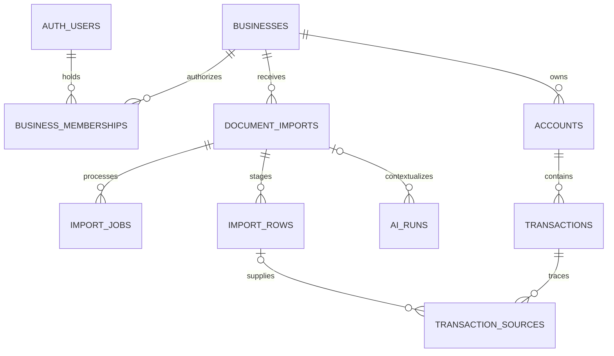

# CashLens: bank statement imports

Approved scope extension, September 12, 2026. Proposed design, not implemented functionality. This document supersedes synthetic-only scope and anonymous-only ownership assumptions in the earlier blueprint, playbook, and diagrams. Existing synthetic demo behavior remains required.

## Product outcome

Offer two entry paths: **Explore demo businesses** and **Use my bank statement**. A reviewer can import their own supported file, review extracted transactions, and generate fresh analysis using the same calculations and AI capabilities as the fictional businesses. Manual imports remain a useful ongoing alternative to connected banking.

CashLens is an independent project, with no affiliation with any other company. Use CashLens consistently in the README and UI.

## Initial scope and boundaries

- Support CSV transaction exports and text-based PDF bank statements for USD checking and savings accounts. Start with one account per import; multiple private accounts can be added through separate imports.
- CSV supports a column-mapping preview for date, description, amount or debit/credit columns, with explicit date format and sign interpretation.
- PDF support begins with representative layouts covered by synthetic test fixtures. Do not claim every bank format is supported. Scanned/image-only PDFs, photographs, password-protected documents, credit-card statements, invoices, and spreadsheets are later work. Detect unsupported inputs and explain the limitation before claiming completion.
- Proposed demo limits: 10 MB per file, 20 PDF pages, 5,000 CSV rows, one processing job per user. Confirm feasibility during the deployment spike; enforce limits server-side and after parsing.
- A statement is historical evidence. Show its coverage dates and balance as-of date. Do not label an old closing balance as today's available cash.
- Allow historical analysis without a balance. Require a dated, owner-confirmed balance before cash-balance projections when no usable statement balance exists. Distinguish this input from bank-observed information.
- Incomplete periods must not be compared as complete weeks. Sparse data can produce a limited brief; forecasting should request assumptions or report insufficient history.
- Future Plaid support is an additional provider adapter plus Link, secure token storage, webhooks, cursor sync, and transaction lifecycle handling. It is not just an API key change.

## User flow

Review UI: file status, masked account label, statement dates, extracted row count, credits/debits, balance reconciliation where possible, and warnings. Display original text or page reference alongside uncertain rows. Let users correct dates, signs, amounts and descriptions, confirm account mapping, and resolve potential duplicates. Never hide extraction failures by silently skipping rows. Import success appears only after confirmation and an atomic commit. Classification uncertainty is distinct from extraction uncertainty.

The public reviewer path should not require actual financial disclosure: supply downloadable synthetic CSV and PDF files that use exactly the same upload workflow. Real uploads require authenticated access. Keep the original three demos frictionless.

## Architecture and functions

| Function | Responsibility |
|---|---|
| create_import | Authorize membership, reserve quota, issue constrained upload access, create import identity |
| validate_upload | Verify actual file type, byte size, allowed parser, page/row bounds and ownership |
| extract_statement | Deterministic CSV/PDF parsing first; bounded structured AI extraction for supported ambiguous PDF layouts |
| validate_extraction | Validate money/dates/currency, row provenance, period and totals; flag contradictions |
| review_import | Save owner edits and duplicate decisions on a revisioned draft |
| confirm_import | Check reviewed revision, authorization and idempotency, then atomically publish normalized records |
| analyze_business | Reuse classifications, metrics, briefs, evidence and scenarios with private business scope |
| delete_private_data | Revoke access immediately and remove owned documents, imports, transactions and dependent outputs through retryable cleanup |

Use one canonical transaction representation: business/account scope, signed minor-unit amount (inflows positive), posted date, currency, description, source type, source reference, revision and provenance. Convert each source's sign convention in its adapter. Uploaded records do not need fabricated Plaid IDs or sync cursors.

PDF text is untrusted data, never tool instructions. AI can propose structured rows with page/line evidence. It cannot execute money movement or determine authoritative arithmetic. Validate proposed rows and perform balance reconciliation in Python. A balanced total is a useful check, not proof every extracted row is correct. Send only necessary statement text to the model, mask unnecessary identifiers, and disclose the external AI processing in the upload flow. Keep real statement imports on direct OpenAI initially; use OpenRouter comparisons only on synthetic fixtures until provider routing/data handling is deliberately configured.

Do not launch untracked background tasks after returning a serverless response. Persist job status and use bounded, resumable processing requests that the UI polls. During the deployment spike verify parser/model timeouts with supported files. If processing cannot fit safely, add a durable worker as an explicit architecture decision before enabling that path. Retries must lease the job, cap attempts, and avoid duplicate commits or repeated unrestricted model spending.

## Ownership and schema changes

Keep demo visitors/workspaces for synthetic exploration. Add authenticated users and memberships for private businesses; do not store real bank data under a browser identifier alone. Supabase Auth is the proposed sign-in mechanism.

| Entity | New or changed fields and relationships |
|---|---|
| businesses | data_mode = demo/private; private rows require membership; demo seeds stay immutable |
| business_memberships | composite PK (business_id, user_id); user_id references auth.users; role; initial owner only |
| workspaces | visitor_id nullable, user_id nullable; exactly one identity present; enforce allowed business mode; unique visitor/business or user/business where applicable |
| accounts | source_type; connection_id nullable for manual imports; account label and last four digits optional; account identity must be confirmed for overlap checks |
| document_imports | id, business_id, uploaded_by, object_path, hash, format, status, draft_revision, extraction_version, reviewed_by, confirmed_at, error_code, expires_at |
| import_jobs | id, import_id, state, attempts, lease_expires_at, idempotency_key, safe_error; bounded retry and restart |
| import_rows | id, import_id, row_index, page_number nullable, source locator, extracted fields, reviewed fields, validation flags; unique import/row_index |
| transaction_sources | id, transaction_id, import_row_id nullable, raw_event_id nullable; exactly one source; many sources may support one transaction |
| transactions | source_type and nullable provider external_id; keep business/account ownership, amount/date/revision rules |
| balance_snapshots | provenance and as_of; statement closing balance distinct from current/available balance; owner confirmations labeled |
| ai_runs | business_id, import_id nullable, workspace_id nullable; extraction may run before a workspace snapshot exists; enforce consistent business scope |
| analytics_events | data_mode; no file names, contents, descriptions, amounts or full questions |

Enforce linked business scope with composite foreign keys or equivalent database constraints. A forged business/import/account ID must not grant access. Supabase table and Storage policies need separate tests. Privileged server keys bypass RLS, so backend membership checks are still mandatory wherever those keys are used.

## Duplicate handling and provenance

Within the same business/account, identical file hash should return the existing import rather than import it twice. Identical reviewed import confirmation must be idempotent. Similar amount/date/description rows across overlapping statements are only duplicate candidates: two legitimate purchases can have identical values. Ask the owner to keep both or link to the existing transaction; preserve separate provenance for linked evidence. Never deduplicate across unrelated businesses. If no trusted bank transaction ID exists, do not present heuristic matching as certainty.

Original draft rows and approved corrections retain provenance while stored. A failed confirm inserts no partial transaction set. Committed revisions invalidate dependent metrics and briefs. Deleted private data is a deliberate exception to retained historical replay: remove its downstream copies as well.

## Private upload requirements

- Private Storage bucket and authenticated, owner-scoped read/write/delete policies. Use bounded signed access where needed; object paths are not authorization.
- Backend validates membership for every import, poll, review, confirm, evidence and deletion request. Do not expose statement contents or private AI traces through the public technical viewer.
- File, row, extraction-text and model-spend limits; atomically reserve quotas before paid work. Prevent parser resource exhaustion. Never execute file content or fetch links embedded in it.
- No real statements, extracted transactions, model payloads, storage URLs or private screenshots in Git, CI fixtures, analytics, or ordinary logs. Add local upload/temp directories to .gitignore.
- Upload notice explains private storage, external AI processing, supported inputs, and deletion. Proposed original-file retention: delete within 24 hours after successful confirmation; abandoned/failed files expire within 24 hours. Keep normalized data until user deletion. This requires a working scheduled cleanup mechanism; do not promise it in UI until verified.
- Delete my data removes active files, staging, private transactions, classifications, overrides, snapshots, insights, scenarios and AI payloads. Cancel pending processing and clear caches. Preserve only non-content operational status needed for retry. Describe backup/provider retention separately; do not promise immediate removal from all backups.
- Once source files expire, evidence links show retained normalized rows and original page references, not a broken file preview.

## A/B experiment update

Keep the initial layout experiment restricted to synthetic demo mode, preserving its existing definition and denominator. Upload onboarding and private-data use receive separate aggregate operational metrics: successful extraction, review corrections, confirmation, failures, and processing time. Do not mix private-upload users with demo participants to claim a layout winner. Private uploads still use the same layout style and financial functions.

## Build sequence and genuine commits

Insert private ownership before import development and before inviting real uploads. The estimate of four build days in the earlier plan must be re-estimated after this expansion. Prefer finishing CSV and supported text-PDF uploads over adding optional OpenRouter or scanned-document support before the interview.

| Order | Commit when work is completed | Completion gate |
|---|---|---|
| 0 | docs: add private statement import design | Scope, schema, diagrams and limitations agree |
| 1 | feat: add authenticated private business access | Cross-user API, table, storage and trace access tests pass |
| 2 | feat: add shared source contract and CSV import review | Synthetic and CSV input reach identical canonical calculations; correction flow works |
| 3 | feat: extract text PDF statements with source evidence | Supported-layout fixtures, sign/date cases, row provenance and unsupported-file feedback work |
| 4 | feat: confirm imports with duplicate review and reconciliation | Atomic commit, retries, overlap ambiguity and balance checks pass |
| 5 | feat: analyze uploaded statements in the CFO workspace | Fresh classification, brief, scenario and evidence use only uploaded business records |
| 6 | feat: add import quotas and private data cleanup | Budget, expiration, cancellation and complete deletion checks pass before public real uploads |
| 7 | docs: publish statement upload walkthrough and limitations | Synthetic downloadable files and actual screenshots demonstrate genuine ingestion |

Implement one vertical slice first: sign in, import one CSV, review, confirm, generate brief. Extend that slice to supported text PDFs. Do not accept real public uploads before isolation, quotas and cleanup are verified. Synthetic documents can exercise unfinished paths locally.

## Required verification

Known-answer CSV/PDF fixtures must contain only synthetic data. Cover split descriptions, debit/credit columns, locale/date ambiguity, negative signs, period boundaries, missing balances, mismatched totals, repeated legitimate payments, overlapping statements, malformed files, oversized inputs, PDF prompt injection, parser/model failures, review revision conflicts, repeat confirmation, and deletion while a job is active. Prove user A cannot access user B's file, job, transaction, evidence, brief or trace. Confirm fixture and upload versions of the same records produce identical deterministic metrics. Report PDF coverage and extraction accuracy honestly; one successful file is not broad bank support.

## Interview wording, once implemented and verified

"CashLens can analyze the sample businesses or a bank statement you upload. Imported transactions go through review and then the same classification, financial calculations and AI explanations. I separated ingestion from analysis so a bank connector can feed that pipeline later. Account linking and ongoing synchronization are the next integration work."

## References

- [Supabase Storage access control](https://supabase.com/docs/guides/storage/security/access-control): private object authorization and service-key behavior.
- [Plaid Transactions](https://plaid.com/docs/transactions/): account linking and incremental synchronization integration.
